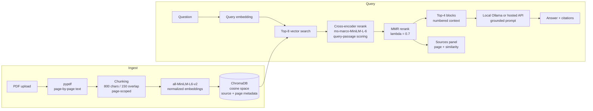

# RAG Document Assistant


-6B46C1)


A local-first Retrieval-Augmented Generation assistant for PDF documents: upload PDFs, ask questions in plain language, and get answers grounded in the documents' own text — with the page each answer came from.

Chunking and embeddings run **entirely on the local machine** (`all-MiniLM-L6-v2` via `sentence-transformers`). Only the retrieved fragments and the question are sent to the LLM.


---

## Features

- **Upload from the browser**, several PDFs at once — no CLI needed to index.
- **Page-level citations** — every answer links to `source · page N · similarity`, with the retrieved excerpts in a collapsible panel.
- **Overlapping chunking** (800 chars / 150 overlap) cut on word boundaries, never across pages.
- **Two-stage reranking** — a cross-encoder (`ms-marco-MiniLM-L-6-v2`) re-reads each query–passage pair, then MMR picks for relevance *and* diversity. Both stages toggle independently in the UI.
- **Multi-document workspace** — per-document chunk/page counts, per-document delete, document-scoped filtering, one-click reset.
- **Persistent vector store** — ChromaDB on disk; the index survives restarts.
- **Grounded prompt** — the model is instructed to answer only from context and to refuse otherwise.
- **Measured, not guessed** — a 6-document corpus, 29 labelled questions, a 9-configuration retrieval ablation, and a gold-label validator that fails the run when a rubric drifts.
- **33 unit tests** — chunker behaviour, provider resolution, refusal detection, ranking order, citation mapping, stage switches, eval labels.

## Architecture



## How it works

1. **Extraction** — `pypdf` pulls text page by page; an unreadable page yields `""` instead of failing the job.
2. **Chunking** — each page is split into ~800-character windows, cut on newline/space/period so words stay intact, with 150 characters of overlap; short tails are merged into the previous chunk.
3. **Embedding** — every chunk is encoded locally with normalized 384-d vectors.
4. **Storage** — one ChromaDB collection in cosine space, ids `"{source}:{page}:{index}"`. Re-indexing deletes the document's previous chunks first, so an edited PDF cannot leave stale tails.
5. **Retrieval** — the question is embedded with the same model, 8 candidates are pulled, a cross-encoder scores each query–passage pair jointly (it is the only stage that sees the question and the passage together), then MMR (λ = 0.7) narrows them to 4. Both stages are switches; `RERANK_ENABLED=0` falls back to plain MMR order.
6. **Generation** — blocks are numbered `[1]…[4]` with source and page inside each block; the model answers only from them and cites the blocks it used.

## Evaluation

### Corpus

`eval/corpus/` holds 6 synthetic PDFs, 3 pages each (18 pages, 18 chunks at 800/150). The content is deliberately adversarial for retrieval:

- every document has a "Limitations" / "notes" page with similar wording, so lexical matching alone picks the wrong file;
- several documents discuss the same concepts (chunk size, overlap, top-k, citations) and only the numbers differ;
- facts are pinned to specific pages, which is what the citation metric needs.

It is a **test fixture, not a benchmark**: the numbers are internally consistent but invented, and the point is comparing configurations against each other.

### Questions

`eval/qa_set.jsonl` — 29 questions: 25 in-scope lookups spread across all 6 documents, 4 out-of-scope questions the corpus cannot answer (the only direct test of grounding). Before scoring, `validate_qa_set()` re-reads every gold page and checks that it actually contains the fact the question asks about; a mismatch aborts the run.

### Retrieval results (default config: 800/150, retrieve 8 → cross-encoder → MMR, k = 4)

| Metric | Result | What it measures |
|---|---|---|
| hit@k | **1.00** (25/25) | gold (document, page) present in the returned set |
| hit@1 | **0.96** (24/25) | the first returned chunk is the gold one |
| MRR | **0.980** | 1/rank of the first correct chunk |

The one question that is retrieved but not first (`c04`, a table-extraction question) used to be the only outright miss before the cross-encoder was added; the block is now in the window, at rank 2. `hit@k` at 1.00 means every gold page reaches the prompt — which is what makes the remaining citation problem measurable instead of hidden behind retrieval errors.

### Ablation — does the configuration actually matter?

`python eval/run_ablation.py` (retrieval only, no model-generated answers; cost is CPU only):

| Config | Chunks | hit@k | hit@1 | MRR | s/question |
|---|---|---|---|---|---|
| 500 / 0, no MMR, k=3 | 31 | 0.960 | 0.840 | 0.893 | 0.09 |
| 500 / 50, no MMR, k=3 | 34 | 0.960 | 0.840 | 0.893 | 0.03 |
| 800 / 150, no MMR, k=3 | 18 | 0.960 | 0.880 | 0.920 | 0.03 |
| 800 / 150, MMR, k=3 | 18 | 0.960 | 0.880 | 0.913 | 0.03 |
| 800 / 150, MMR, k=4 | 18 | 0.960 | 0.880 | 0.913 | 0.03 |
| 800 / 150, **CE**, k=3 | 18 | **1.000** | **0.960** | **0.980** | 4.29 ¹ |
| 800 / 150, **CE**, k=4 | 18 | **1.000** | **0.960** | **0.980** | 0.34 |
| 800 / 150, **CE + MMR**, k=3 | 18 | **1.000** | **0.960** | **0.980** | 0.33 |
| 800 / 150, **CE + MMR**, k=4 | 18 | **1.000** | **0.960** | **0.980** | 0.39 |

¹ the first CE row includes the one-time model load (~4 s); every later row is steady-state. Every configuration misses only `p04` except the CE ones, which recover it.

Four honest readings:

1. **Larger chunks won on this corpus**: 800/150 beats 500-char chunks on hit@1 (+4 points) and MRR (+0.027), with 13 fewer chunks. Longer windows keep a full paragraph together, and the answers here live inside paragraphs.
2. **Overlap did not move the ranking** at 500 chars (identical to no overlap). Overlap protects boundary recall, which hit@1 largely cannot see — it is a safety margin, not a free win.
3. **MMR cost 0.007 MRR on top of the vector stage.** It pushes the exact gold chunk slightly down in exchange for context diversity, which this metric cannot observe. It stays enabled because the prompt benefits from non-redundant blocks — but claiming it improves retrieval would be wrong.
4. **The cross-encoder is the one change that moved the ceiling**, not the margin: `hit@k` 0.96 → **1.00** (the single miss, `p04`, is recovered), `hit@1` 0.88 → **0.96**, MRR 0.913 → **0.980**. It costs ~0.3 s per query on CPU and adds no retrieval misses back. Notably, MMR applied *after* the cross-encoder costs nothing here — MMR reorders within a list the CE has already ranked correctly, and with only 8 candidates the diversity term rarely overrides a strong CE score.

Two caveats on reading the CE row: the reranker is `ms-marco`, trained on **English** MS MARCO passages, so these numbers say "it works on English text", not "it works on Chinese or Russian PDFs". And with 25 questions, one recovered question is 4 points of `hit@1` — the direction is solid, the exact magnitude is not.

### Answer-level results (local 3B model, no API account)

Generated with `LLM_PROVIDER=ollama`, `qwen2.5:3b`, temperature 0.2, no hosted calls at all, retrieval running the full cross-encoder pipeline. 29 answers, `api_errors: 0`.

| Metric | Before CE | With CE | What it measures |
|---|---|---|---|
| answer accuracy (lexical key match) | 0.92 (23/25) | **0.96** (24/25) | the answer contains the fact's key token |
| answer accuracy (manual audit) | 0.96 (24/25) | **1.00** (25/25) | each answer read against the gold page |
| citation rate | 1.0 (25/25) | **1.0** (25/25) | every answer carries at least one `[n]` |
| **citation gold rate** | — | **0.80** (20/25) | the cited `[n]` maps to the gold page |
| refusal rate | 1.0 (4/4) | **1.0** (4/4) | out-of-scope questions are declined, not answered |

Five things worth reading before trusting these numbers:

1. **Retrieval is no longer the weak link; citation attribution is.** `citation_gold_rate` is a new, stricter metric: it maps `[n]` back to the block that was actually shown and asks whether that block's page is the gold page. 20 of 25 pass. In all five failures the gold page was **block `[1]`, ranked first**, and the model cited `[2]` or `[3]` — `e05` (`[2]`), `v02` (`[3]`), `c03` (`[3]`), `p04` (`[2]`), `d04` (`[2]`). The answer text is right in all five. This is textbook citation drift, the exact failure the corpus page `prompt-design.pdf` describes — and the presence-only `citation_rate` scores it 1.0. That is why both metrics are now reported side by side.
2. **The cross-encoder fixed the one answer that used to be wrong.** `p04` asks what claim-by-claim verification catches that rate-based metrics cannot; before CE the gold page never reached the prompt and the model answered "contamination". Now the page is block `[1]`, the answer names citation drift, and lexical accuracy rises 0.92 → 0.96. The remaining defect there is the citation bracket (`[2]`), not the content.
3. **Lexical accuracy undercounts by one; the manual audit does not.** I read all 25 in-scope answers against the gold pages: **25/25 are substantively correct**, and `d04` ("what is a link in a PDF") is the only one the string match misses — it paraphrases "annotation" as "clickable rectangle with an action". So lexical 0.96 and manual 1.00 describe the same run, and the drift in point 1 is a citation problem, not an answer problem.
4. **Four out of four refusals are real refusals**, not lucky keyword hits — `o01`–`o04` each state that the context does not contain the answer. The detector also has a negation regex, because a marker list alone once scored a correct refusal as a miss.
5. **The LLM judge was tried and rejected.** The same 3B model scored 7 grounded answers as 1/5, and a controlled case scored `2` through the OpenAI-compatible shim versus `4` through Ollama's native API. An uncalibrated instrument is worse than no instrument, so the committed report carries `judge_mean_faithfulness: null` and the experiment is kept as evidence in `eval/reports/judge_experiment.json`. Per-answer verdicts are in `eval/reports/answer_audit.md`.

Latency on this machine: 46.7 s mean per question (retrieval + generation), 60.6 s max — usable for an audit, too slow for an interactive demo. A hosted model answers in 1–3 s; the code path is identical. Retrieval alone, including the cross-encoder, is 0.3–0.4 s per question.

Each run indexes into a throwaway store, so results never depend on your working collection. Reports land in `eval/reports/`.

```powershell
python eval/run_eval.py                     # retrieval + answers + citation/refusal metrics
python eval/run_eval.py --judge             # add LLM judging (reliable only with a hosted model)
python eval/run_eval.py --no-answers        # retrieval only, no model calls
python eval/run_eval.py --rescore eval/reports/latest.json   # re-score stored answers, no model calls
```

## Tech stack

| Layer | Choice |
|---|---|
| UI | Streamlit |
| PDF parsing | pypdf |
| Embeddings | sentence-transformers `all-MiniLM-L6-v2` (local, CPU) |
| Vector store | ChromaDB (`PersistentClient`, cosine space) |
| Reranking | cross-encoder `ms-marco-MiniLM-L-6-v2` + MMR over candidate embeddings (numpy) |
| LLM | provider-agnostic: any OpenAI-compatible endpoint, or local Ollama |
| Corpus fixtures | reportlab (dev only) |
| Tests | pytest |

## Quick start

**Prerequisites:** Python 3.11+. A hosted API key is optional — the default backend is a local Ollama model, which needs no account, no card and no network once the model is pulled.

```powershell
python -m venv venv
.\venv\Scripts\Activate.ps1
pip install -r requirements.txt
```

Create `.env` (git-ignored) — or copy `.env.example`:

```ini
# Offline: no key at all
LLM_PROVIDER=ollama
LLM_MODEL=qwen2.5:3b

# Or a hosted endpoint (same code, one .env edit)
# LLM_PROVIDER=dashscope
# QWEN_API_KEY=sk-your-key-here
# LLM_MODEL=qwen-plus
```

Launch the web UI:

```powershell
streamlit run ui.py
```

Streamlit opens `http://localhost:8501`. Drop PDFs into the sidebar → **Process documents** → ask questions.

> `pip install` and Hugging Face model downloads go through `hf-mirror.com` by default (set in `config.py`), because the upstream endpoint is often unreachable from mainland China.

### Generation backend

`src/config.py:resolve_llm` picks the endpoint from the environment, so the same pipeline runs against a vendor API, a self-hosted proxy or a local model. Presets: `ollama`, `dashscope`, `deepseek`, `moonshot`, `zhipu`, `openai`; every field is overridable with `LLM_BASE_URL`, `LLM_MODEL`, `LLM_API_KEY`.

Two things that are easy to get wrong, and are therefore tested in `tests/test_config.py`:

- legacy `QWEN_*` variables are honoured **only** for `dashscope` — otherwise a leftover `QWEN_BASE_URL` silently redirects a local client to a paid endpoint;
- local inference gets a longer timeout and a capped `LLM_MAX_TOKENS`, because a 3B model on CPU does not answer in three seconds.

> Hosted-endpoint failure modes: `404 Model not exist` means the endpoint does not serve that model; `400 Access denied — overdue payment` means the account balance is negative. In both cases indexing and retrieval keep working — embeddings are local — so the app degrades to a citation browser instead of dying.

### CLI

```powershell
python app.py                    # index every PDF in data/
python app.py data/real.pdf      # index one file
python query.py                  # interactive Q&A with citations
python query.py --k 6 --source real.pdf
```

### Tests and evaluation

```powershell
pip install -r requirements-dev.txt
pytest -q                        # 30 tests
python eval/build_corpus.py      # regenerate the corpus PDFs
python eval/run_ablation.py      # config comparison, no API cost
```

## Project structure

```
rag-document-assistant/
├── src/
│   ├── config.py        # env loading, paths, defaults, LLM provider resolution
│   ├── chunking.py      # page-aware overlapping windows, short-tail merging
│   ├── embeddings.py    # lazy singleton SentenceTransformer, normalized vectors
│   ├── store.py         # ChromaDB layer: upsert, delete-by-source, cosine query
│   ├── rerank.py        # lazy cross-encoder singleton, min-max normalized scores
│   ├── retrieval.py     # vector search → cross-encoder → MMR
│   ├── generation.py    # prompt assembly, vendor-neutral client, retry/backoff
│   └── ingest.py        # PDF -> pages -> chunks -> embeddings -> store
├── ui.py                # Streamlit app (upload, chat, citations, settings)
├── query.py             # interactive CLI
├── app.py               # CLI ingestion
├── eval/
│   ├── corpus_source.py # content of the 6 synthetic documents
│   ├── build_corpus.py  # renders corpus_source.py into PDFs
│   ├── corpus/          # generated PDFs (committed, ~4 KB each)
│   ├── qa_set.jsonl     # 29 questions with doc + page gold labels
│   ├── run_eval.py      # validation, hit@k, hit@1, MRR, answer + citation-target metrics, --rescore
│   ├── run_ablation.py  # 9-configuration retrieval comparison with per-question latency
│   └── reports/         # latest.json, ablation.json, answer_audit.md, judge_experiment.json
├── tests/
│   ├── test_chunking.py    # 8 cases
│   ├── test_config.py      # 5 cases (provider resolution, legacy-env traps)
│   ├── test_refusal.py     # 6 cases (refusal detection across phrasings)
│   ├── test_retrieval_stages.py # 6 cases (rerank-score ordering, citation mapping)
│   ├── test_retrieval_switches.py # 3 cases (stage flags actually skip their stage)
│   └── test_eval_labels.py # 5 cases
├── data/                # source PDFs (git-ignored)
├── chroma_db/           # persisted vector store (git-ignored)
└── docs/demo.png
```

## Design decisions

- **Page-scoped chunks over "perfect" chunks.** Chunks never cross a page boundary, which costs a little context on pages that continue mid-sentence but guarantees every citation carries a real page number.
- **Fixed windows + overlap, not semantic splitting.** At this corpus size the simplest approach is also the one that is easy to unit-test; a semantic splitter can be swapped in behind the same interface.
- **MMR, priced honestly.** It trades a little retrieval precision for context diversity; the ablation shows the price (0.007 MRR) when it runs directly on cosine scores. The value is in the prompt, and the README says so instead of pretending the retrieval metric improved.
- **Cross-encoder before diversity.** A bi-encoder embeds the question and the chunk separately, so it can only compare two summaries of meaning; a cross-encoder reads them together and is strictly better at ordering. It is the last stage to run *before* MMR, so the diversity pass reorders an already-correct list rather than rescuing a wrong one. Scores are min-max normalized into `rerank_score` and kept separate from the cosine `score`, so the UI still shows a number that is comparable across queries.
- **Delete-then-upsert.** Positional ids (`doc_0`, `doc_1`, …) break on the second document; per-source ids plus delete-first ingest make re-indexing idempotent.
- **Labels are validated, not trusted.** Every eval run re-reads the gold pages and refuses to score if a label no longer matches the document.
- **Metrics are audited before they are published.** A metric that scores clearly correct answers as failures gets fixed or removed, not reported. That is why the judge is null and the refusal detector has a negation fallback.
- **Local embeddings.** Indexing stays free and offline; the 18-page corpus indexes in seconds on CPU.
- **Provider-agnostic generation.** The same pipeline runs on a hosted API or a local model; the vendor is a config value, and the offline path needs no account or card.

## Limitations & roadmap

- **Synthetic corpus.** Six documents written to stress retrieval by design — good for comparing configurations, useless as a claim about real-world libraries.
- **18 chunks is still small.** Enough for `hit@1` to discriminate, not enough for tight confidence intervals; there are no repeated runs or variance estimates.
- **Citation correctness is only partly measured.** `citation_rate` checks that a bracket exists; a newer `citation_gold_rate` checks that the cited block actually maps to the gold page. Neither proves every *sentence* is supported — claim-level verification is still on the roadmap.
- **The faithfulness judge needs a stronger model.** A 3B judge is uncalibrated and was rejected; the metric returns only when judging runs on a hosted model.
- **Local generation is slow.** ~47 s per answer on CPU. Good enough to prove the pipeline works offline, not good enough to demo interactively.
- **The cross-encoder is an English model.** `ms-marco-MiniLM-L-6-v2` was trained on English MS MARCO; Chinese or Russian documents have no measured reranker yet — a multilingual `bge-reranker` is the swap.
- **First query pays for the reranker.** The model (~90 MB) downloads on first use and loads in ~4 s; afterwards it is steady at ~0.3 s/query on CPU.
- **Scanned PDFs are not handled.** No OCR fallback; text-less pages are reported as "no extractable text".
- **No streaming.** The answer appears when the full response arrives.
- **Single collection.** Document filtering works, but there is no notion of workspaces or per-user isolation.

Planned order: claim-level citation check → multilingual reranker → OCR fallback → streaming → a real-world corpus with variance estimates.

## 中文简介

面向 PDF 文档的检索增强生成（RAG）问答助手。切分、向量化均在本地完成（`all-MiniLM-L6-v2`），只有检索到的片段与问题会发送给生成模型。

- **核心能力**：页码级引用（`文件名 · 页码 · 相似度`）、800/150 重叠切块、cross-encoder 重排 + MMR、多文档管理
- **技术栈**：Streamlit + pypdf + sentence-transformers + ChromaDB + 任意 OpenAI 兼容接口（DashScope / DeepSeek / 本地 Ollama）
- **评测**：自建 6 文档 / 18 页合成语料 + 29 道人工题目；9 组配置对比中，cross-encoder 把检索从 hit@k 0.96 / hit@1 0.88 / MRR 0.913 提到 **1.00 / 0.96 / 0.980**（每题约 0.3 秒），并且补上了唯一漏检 `p04`；不加时 800/150 优于 500 字符，MMR 代价为 0.007 MRR
- **答案层指标**：本地 `qwen2.5:3b` 生成 29 条答案，引用率 1.0、拒答率 1.0、关键词命中 0.92；人工复核 24/25 正确。LLM 评委（judge）因 3B 模型打分不可靠被弃用，实验记录保留在 `eval/reports/judge_experiment.json`
- **运行**：配置 `.env`（参考 `.env.example`）后执行 `streamlit run ui.py`；默认走本地 Ollama，无需 API Key 与付费账号

## License

MIT — see [LICENSE](LICENSE).
