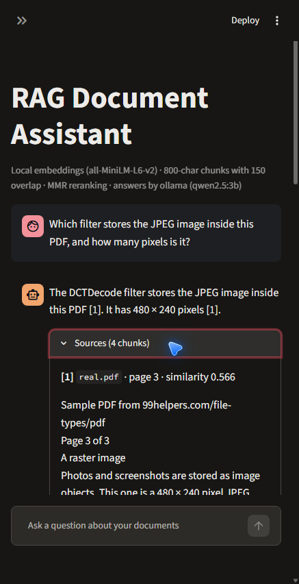
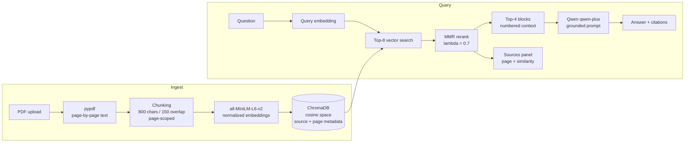

# RAG Document Assistant


-6B46C1)


A local-first Retrieval-Augmented Generation assistant for PDF documents: upload PDFs, ask questions in plain language, and get answers grounded in the documents' own text — with the page each answer came from.

Chunking and embeddings run **entirely on the local machine** (`all-MiniLM-L6-v2` via `sentence-transformers`). Only the retrieved fragments and the question are sent to the LLM.



---

## Features

- **Upload from the browser**, several PDFs at once — no CLI needed to index.
- **Page-level citations** — every answer links to `source · page N · similarity`, with the retrieved excerpts in a collapsible panel.
- **Overlapping chunking** (800 chars / 150 overlap) cut on word boundaries, never across pages.
- **MMR reranking** — 8 candidates from the vector index, 4 selected for relevance *and* diversity.
- **Multi-document workspace** — per-document chunk/page counts, per-document delete, document-scoped filtering, one-click reset.
- **Persistent vector store** — ChromaDB on disk; the index survives restarts.
- **Grounded prompt** — the model is instructed to answer only from context and to refuse otherwise.
- **Measured, not guessed** — a 6-document corpus, 29 labelled questions, a retrieval ablation across 5 configurations, and a gold-label validator that fails the run when a rubric drifts.
- **13 unit tests** — chunker behaviour plus the eval label validator.

## Architecture



## How it works

1. **Extraction** — `pypdf` pulls text page by page; an unreadable page yields `""` instead of failing the job.
2. **Chunking** — each page is split into ~800-character windows, cut on newline/space/period so words stay intact, with 150 characters of overlap; short tails are merged into the previous chunk.
3. **Embedding** — every chunk is encoded locally with normalized 384-d vectors.
4. **Storage** — one ChromaDB collection in cosine space, ids `"{source}:{page}:{index}"`. Re-indexing deletes the document's previous chunks first, so an edited PDF cannot leave stale tails.
5. **Retrieval** — the question is embedded with the same model, 8 candidates are pulled, MMR (λ = 0.7) narrows them to 4.
6. **Generation** — blocks are numbered `[1]…[4]` with source and page inside each block; the model answers only from them and cites the blocks it used.

## Evaluation

### Corpus

`eval/corpus/` holds 6 synthetic PDFs, 3 pages each (18 pages, 18 chunks at 800/150). The content is deliberately adversarial for retrieval:

- every document has a "Limitations" / "notes" page with similar wording, so lexical matching alone picks the wrong file;
- several documents discuss the same concepts (chunk size, overlap, top-k, citations) and only the numbers differ;
- facts are pinned to specific pages, which is what the citation metric needs.

It is a **test fixture, not a benchmark**: the numbers are internally consistent but invented, and the point is comparing configurations against each other.

### Questions

`eval/qa_set.jsonl` — 29 questions: 25 in-scope lookups spread across all 6 documents, 4 out-of-scope questions the corpus cannot answer (the only direct test of grounding). Before scoring, `validate_qa_set()` re-reads every gold page and checks that it actually contains the fact the question asks about; a mismatch aborts the run.

### Retrieval results (default config: 800/150, retrieve 8, MMR, k = 4)

| Metric | Result | What it measures |
|---|---|---|
| hit@k | **0.96** (24/25) | gold (document, page) present in the returned set |
| hit@1 | **0.88** (22/25) | the first returned chunk is the gold one |
| MRR | **0.913** | 1/rank of the first correct chunk |

The single remaining miss is `p04` ("what does claim-by-claim verification catch that rate-based metrics cannot") — both documents that discuss citation metrics are retrieved, just not the page that states it. That is a realistic failure, not a wiring bug.

### Ablation — does the configuration actually matter?

`python eval/run_ablation.py` (retrieval only, no API calls):

| Config | Chunks | hit@1 | MRR |
|---|---|---|---|
| 500 chars / 0 overlap, no MMR, k=3 | 31 | 0.840 | 0.893 |
| 500 chars / 50 overlap, no MMR, k=3 | 34 | 0.840 | 0.893 |
| 800 chars / 150 overlap, no MMR, k=3 | 18 | **0.880** | **0.920** |
| 800 / 150, MMR, k=3 | 18 | 0.880 | 0.913 |
| 800 / 150, MMR, k=4 | 18 | 0.880 | 0.913 |

Three honest readings:

1. **Larger chunks won on this corpus**: 800/150 beats 500-char chunks on hit@1 (+4 points) and MRR (+0.027), with 13 fewer chunks. Longer windows keep a full paragraph together, and the answers here live inside paragraphs.
2. **Overlap did not move the ranking** at 500 chars (identical to no overlap). Overlap protects boundary recall, which hit@1 largely cannot see — it is a safety margin, not a free win.
3. **MMR cost 0.007 MRR.** It pushes the exact gold chunk slightly down in exchange for context diversity, which this metric cannot observe. It stays enabled because the prompt benefits from non-redundant blocks — but claiming it improves retrieval would be wrong.

### Answer-level metrics: not measured in this report

`run_eval.py` also computes answer accuracy, citation rate, refusal rate and an LLM-judge faithfulness score, but the DashScope account hit its quota mid-run (`400 Access denied — overdue payment`). Rather than publish numbers produced while the API was failing, the committed report contains retrieval metrics only, and the script now flags such runs:

```json
"api_errors": 0, "answer_metrics_valid": null
```

With quota restored:

```powershell
python eval/run_eval.py --judge            # answers + citation rate + refusal + judge
python eval/run_eval.py --no-answers       # retrieval only, no API cost
```

Each run indexes into a throwaway store, so results never depend on your working collection. Reports land in `eval/reports/`.

## Tech stack

| Layer | Choice |
|---|---|
| UI | Streamlit |
| PDF parsing | pypdf |
| Embeddings | sentence-transformers `all-MiniLM-L6-v2` (local, CPU) |
| Vector store | ChromaDB (`PersistentClient`, cosine space) |
| Reranking | MMR over candidate embeddings (numpy) |
| LLM | provider-agnostic: any OpenAI-compatible endpoint, or local Ollama |
| Corpus fixtures | reportlab (dev only) |
| Tests | pytest |

## Quick start

**Prerequisites:** Python 3.11+. A hosted API key is optional — the default backend is a local Ollama model, which needs no account, no card and no network once the model is pulled.

```powershell
python -m venv venv
.\venv\Scripts\Activate.ps1
pip install -r requirements.txt
```

Create `.env` (git-ignored) — or copy `.env.example`:

```ini
# Offline: no key at all
LLM_PROVIDER=ollama
LLM_MODEL=qwen2.5:3b

# Or a hosted endpoint (same code, one .env edit)
# LLM_PROVIDER=dashscope
# QWEN_API_KEY=sk-your-key-here
# LLM_MODEL=qwen-plus
```

Launch the web UI:

```powershell
streamlit run ui.py
```

Streamlit opens `http://localhost:8501`. Drop PDFs into the sidebar → **Process documents** → ask questions.

> `pip install` and Hugging Face model downloads go through `hf-mirror.com` by default (set in `config.py`), because the upstream endpoint is often unreachable from mainland China.

### Generation backend

`src/config.py:resolve_llm` picks the endpoint from the environment, so the same pipeline runs against a vendor API, a self-hosted proxy or a local model. Presets: `ollama`, `dashscope`, `deepseek`, `moonshot`, `zhipu`, `openai`; every field is overridable with `LLM_BASE_URL`, `LLM_MODEL`, `LLM_API_KEY`.

Two things that are easy to get wrong, and are therefore tested in `tests/test_config.py`:

- legacy `QWEN_*` variables are honoured **only** for `dashscope` — otherwise a leftover `QWEN_BASE_URL` silently redirects a local client to a paid endpoint;
- local inference gets a longer timeout and a capped `LLM_MAX_TOKENS`, because a 3B model on CPU does not answer in three seconds.

> Hosted-endpoint failure modes: `404 Model not exist` means the endpoint does not serve that model; `400 Access denied — overdue payment` means the account balance is negative. In both cases indexing and retrieval keep working — embeddings are local — so the app degrades to a citation browser instead of dying.

### CLI

```powershell
python app.py                    # index every PDF in data/
python app.py data/real.pdf      # index one file
python query.py                  # interactive Q&A with citations
python query.py --k 6 --source real.pdf
```

### Tests and evaluation

```powershell
pip install -r requirements-dev.txt
pytest -q                        # 18 tests
python eval/build_corpus.py      # regenerate the corpus PDFs
python eval/run_ablation.py      # config comparison, no API cost
```

## Project structure

```
rag-document-assistant/
├── src/
│   ├── config.py        # env loading, paths, defaults, LLM provider resolution
│   ├── chunking.py      # page-aware overlapping windows, short-tail merging
│   ├── embeddings.py    # lazy singleton SentenceTransformer, normalized vectors
│   ├── store.py         # ChromaDB layer: upsert, delete-by-source, cosine query
│   ├── retrieval.py     # vector search + MMR reranking
│   ├── generation.py    # prompt assembly, vendor-neutral client, retry/backoff
│   └── ingest.py        # PDF -> pages -> chunks -> embeddings -> store
├── ui.py                # Streamlit app (upload, chat, citations, settings)
├── query.py             # interactive CLI
├── app.py               # CLI ingestion
├── eval/
│   ├── corpus_source.py # content of the 6 synthetic documents
│   ├── build_corpus.py  # renders corpus_source.py into PDFs
│   ├── corpus/          # generated PDFs (committed, ~4 KB each)
│   ├── qa_set.jsonl     # 29 questions with doc + page gold labels
│   ├── run_eval.py      # validation, hit@k, hit@1, MRR, answer metrics
│   ├── run_ablation.py  # 5-configuration retrieval comparison
│   └── reports/         # latest.json + ablation.json + timestamped runs
├── tests/
│   ├── test_chunking.py    # 8 cases
│   ├── test_config.py      # 5 cases (provider resolution, legacy-env traps)
│   └── test_eval_labels.py # 5 cases
├── data/                # source PDFs (git-ignored)
├── chroma_db/           # persisted vector store (git-ignored)
└── docs/demo.png
```

## Design decisions

- **Page-scoped chunks over "perfect" chunks.** Chunks never cross a page boundary, which costs a little context on pages that continue mid-sentence but guarantees every citation carries a real page number.
- **Fixed windows + overlap, not semantic splitting.** At this corpus size the simplest approach is also the one that is easy to unit-test; a semantic splitter can be swapped in behind the same interface.
- **MMR, priced honestly.** It trades a little retrieval precision for context diversity; the ablation shows the price (0.007 MRR). The value is in the prompt, and the README says so instead of pretending the retrieval metric improved.
- **Delete-then-upsert.** Positional ids (`doc_0`, `doc_1`, …) break on the second document; per-source ids plus delete-first ingest make re-indexing idempotent.
- **Labels are validated, not trusted.** Every eval run re-reads the gold pages and refuses to score if a label no longer matches the document.
- **Local embeddings.** Indexing stays free and offline; the 18-page corpus indexes in seconds on CPU.

## Limitations & roadmap

- **Synthetic corpus.** Six documents written to stress retrieval by design — good for comparing configurations, useless as a claim about real-world libraries.
- **18 chunks is still small.** Enough for `hit@1` to discriminate, not enough for tight confidence intervals; there are no repeated runs or variance estimates.
- **Answer-level metrics are pending.** The harness exists; the committed numbers stopped when the API quota ran out.
- **No cross-encoder reranker.** MMR is diversity-aware but never re-reads the query–passage pair; a `bge-reranker` stage is the obvious upgrade.
- **Scanned PDFs are not handled.** No OCR fallback; text-less pages are reported as "no extractable text".
- **No streaming.** The answer appears when the full response arrives.
- **Single collection.** Document filtering works, but there is no notion of workspaces or per-user isolation.

Planned order: restore quota and publish answer-level metrics → cross-encoder reranking → OCR fallback → streaming → a real-world corpus with variance estimates.

## 中文简介

面向 PDF 文档的检索增强生成（RAG）问答助手。切分、向量化均在本地完成（`all-MiniLM-L6-v2`），只有检索到的片段与问题会发送给 Qwen 生成答案。

- **核心能力**：页码级引用（`文件名 · 页码 · 相似度`）、800/150 重叠切块、MMR 重排、多文档管理
- **技术栈**：Streamlit + pypdf + sentence-transformers + ChromaDB + Qwen（DashScope OpenAI 兼容接口）
- **评测**：自建 6 文档 / 18 页合成语料 + 29 道人工题目；检索 hit@4 = 0.96、hit@1 = 0.88、MRR = 0.913；并对比 5 种切块与重排配置（800/150 优于 500 字符，MMR 在检索指标上代价为 0.007 MRR）。答案层指标（引用率、拒答率、faithfulness）因 API 额度用尽暂未公布
- **运行**：配置 `.env`（参考 `.env.example`）后执行 `streamlit run ui.py`

## License

MIT — see [LICENSE](LICENSE).
