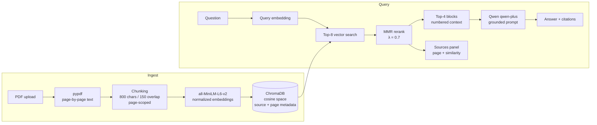

# RAG Document Assistant


-6B46C1)


A local-first Retrieval-Augmented Generation assistant for PDF documents: upload a PDF, ask questions in plain language, and get answers grounded in the document's own text — with the page each answer came from.

Chunking and embeddings run **entirely on the local machine** (`all-MiniLM-L6-v2` via `sentence-transformers`). Only the retrieved fragments and the question are sent to the LLM.


---

## Features

- **Upload from the browser**, several PDFs at once — no CLI needed to index.
- **Page-level citations** — every answer links to `source · page N · similarity`, and the retrieved excerpts are shown in a collapsible panel.
- **Overlapping chunking** (800 chars / 150 overlap) cut on word boundaries, never across pages.
- **MMR reranking** — pulls 8 candidates from the vector index and picks 4 that are relevant *and* not near-duplicates of each other.
- **Multi-document workspace** — per-document chunk/page counts, per-document delete, document-scoped filtering, one-click collection reset.
- **Persistent vector store** — ChromaDB on disk; the index survives restarts.
- **Grounded prompt** — the model is told to answer only from context and to say it does not know otherwise.
- **Evaluation harness** — 18 hand-written questions with retrieval hit-rate, answer accuracy, citation rate and refusal rate.
- **Unit-tested chunker** — 8 pytest cases covering window size, overlap, page boundaries and edge cases.

## Architecture



## How it works

1. **Extraction** — `pypdf` pulls text page by page; an unreadable page yields `""` instead of failing the whole job.
2. **Chunking** — each page is split into ~800-character windows, cut on newline/space/period so words stay intact, with 150 characters of overlap. A short trailing fragment is merged into its neighbour.
3. **Embedding** — every chunk is encoded locally by `all-MiniLM-L6-v2` with normalized vectors (384-d).
4. **Storage** — chunks are written to one ChromaDB collection in cosine space, ids `"{source}:{page}:{index}"`. Re-indexing deletes the document's previous chunks first, so an edited PDF cannot leave stale tails.
5. **Retrieval** — the question is embedded with the same model; the 8 nearest chunks are reranked with MMR (λ = 0.7) down to 4.
6. **Generation** — the 4 blocks are numbered `[1]…[4]` with `source` and `page` attached, and the model is asked to answer only from them and cite the blocks it used.

## Evaluation

Run on `data/real.pdf` (3 pages → 4 chunks) with 18 hand-written questions (17 in-scope, 1 out-of-scope):

| Metric | Result | What it measures |
|---|---|---|
| Retrieval hit@3 | **1.00** (17/17) | gold page present in the top-3 chunks |
| Retrieval hit@1 | **0.94** (16/17) | gold page is the very first chunk |
| Answer accuracy (keyword) | **1.00** (17/17) | answer states the expected fact |
| Citation rate | **1.00** (17/17) | answer cites at least one context block |
| Refusal rate | **1.00** (1/1) | out-of-scope question correctly answered with "I don't know" |
| LLM-judge faithfulness | **5.0 / 5** | same model grading its own answers — a sanity check, not an independent measurement |

**Read this table honestly:** the corpus is tiny (4 chunks), so retrieval metrics are close to their ceiling and prove little more than "the pipeline is wired correctly." The signals worth trusting here are the **grounding** ones — cited answers and a correct refusal on a question the document cannot answer. A larger corpus is the next step; the harness is ready for it.

Reproduce:

```powershell
python eval/run_eval.py --k 3 --judge      # full run with API calls
python eval/run_eval.py --no-answers       # retrieval metrics only, no API cost
```

Each run indexes into a throwaway store, so results never depend on your working collection. Reports land in `eval/reports/`.

## Tech stack

| Layer | Choice |
|---|---|
| UI | Streamlit |
| PDF parsing | pypdf |
| Embeddings | sentence-transformers `all-MiniLM-L6-v2` (local, CPU) |
| Vector store | ChromaDB (`PersistentClient`, cosine space) |
| Reranking | MMR over candidate embeddings (numpy) |
| LLM | Qwen via DashScope, OpenAI-compatible API |
| Config | python-dotenv |
| Tests | pytest |

## Quick start

**Prerequisites:** Python 3.11+ and a Qwen / DashScope API key.

```powershell
python -m venv venv
.\venv\Scripts\Activate.ps1
pip install -r requirements.txt
```

Create `.env` (git-ignored) — or copy `.env.example`:

```ini
QWEN_API_KEY=sk-your-key-here
QWEN_BASE_URL=https://dashscope-intl.aliyuncs.com/compatible-mode/v1
QWEN_MODEL=qwen-plus
```

Launch the web UI:

```powershell
streamlit run ui.py
```

Streamlit opens `http://localhost:8501`. Drop PDFs into the sidebar → **Process documents** → ask questions.

> If a model returns `404 Model not exist`, your endpoint does not serve that model — pick one available on your DashScope account (`QWEN_MODEL` overrides the default).

### CLI

```powershell
python app.py                    # index every PDF in data/
python app.py data/real.pdf      # index one file
python query.py                  # interactive Q&A with citations
python query.py --k 6 --source real.pdf
```

### Tests

```powershell
pip install -r requirements-dev.txt
pytest -q
```

## Project structure

```
rag-document-assistant/
├── src/
│   ├── config.py        # env loading, paths, chunking & retrieval defaults
│   ├── chunking.py      # page-aware overlapping windows, short-tail merging
│   ├── embeddings.py    # lazy singleton SentenceTransformer, normalized vectors
│   ├── store.py         # ChromaDB layer: upsert, delete-by-source, cosine query
│   ├── retrieval.py     # vector search + MMR reranking
│   ├── generation.py    # prompt assembly, Qwen client with retry/backoff
│   └── ingest.py        # PDF -> pages -> chunks -> embeddings -> store
├── ui.py                # Streamlit app (upload, chat, citations, settings)
├── query.py             # interactive CLI
├── app.py               # CLI ingestion
├── eval/
│   ├── qa_set.jsonl     # 18 hand-written questions with gold pages
│   ├── run_eval.py      # metrics: hit@k, hit@1, accuracy, citations, refusal
│   └── reports/         # latest.json + timestamped runs
├── tests/
│   └── test_chunking.py # 8 pytest cases
├── data/                # source PDFs (git-ignored)
├── chroma_db/           # persisted vector store (git-ignored)
└── docs/demo.png
```

## Design decisions

- **Page-scoped chunks over "perfect" chunks.** Chunks never cross a page boundary, which costs a little context on pages that continue mid-sentence but guarantees every citation carries a real page number. Trustworthy citations were worth more than marginally better context.
- **Fixed windows + overlap, not semantic splitting.** Sentence-aware splitting is better in theory, but at 3 pages of text the simplest thing that works is also the thing that is easy to test. The chunker is unit-tested; a semantic splitter can be swapped in behind the same interface.
- **MMR instead of raw top-k.** With 800-char chunks, the three best hits are often three adjacent fragments of the same page — the prompt gets the same paragraph three times. MMR trades a little relevance for coverage.
- **Delete-then-upsert.** Naive positional ids (`doc_0`, `doc_1`, …) break on the second document; per-source ids plus a delete-first ingest make re-indexing idempotent.
- **Prompt constraint.** "Answer only from the context, say you don't know otherwise" — small change, and the out-of-scope test question is refused every time.
- **Local embeddings.** Indexing stays free and offline; a 3-page PDF indexes in seconds on CPU.

## Limitations & roadmap

- **Small corpus.** The evaluation demonstrates correctness on one 3-page document, not robustness across a real library.
- **No cross-encoder reranker.** MMR is diversity-aware but it does not re-read the query–passage pair; a `bge-reranker` stage is the obvious upgrade.
- **Scanned PDFs are not handled.** There is no OCR fallback; text-less pages are reported as "no extractable text".
- **Citations are per chunk, not per sentence.** Inline `[n]` markers are produced by the model; they are checked by rate in the eval, not verified claim by claim.
- **No streaming.** The answer appears when the full response arrives.
- **Single collection.** Document filtering is implemented, but there is no notion of workspaces or per-user isolation.

Planned order: OCR fallback → cross-encoder reranking → streaming answers → citation verification (claim-by-claim) → larger evaluation corpus.

## 中文简介

面向 PDF 文档的检索增强生成（RAG）问答助手。切分、向量化均在本地完成（`all-MiniLM-L6-v2`），只有检索到的片段与问题会发送给 Qwen 生成答案。

- **核心能力**：页码级引用（`文件名 · 页码 · 相似度`）、800/150 重叠切块、MMR 重排、多文档管理、评测脚本
- **技术栈**：Streamlit + pypdf + sentence-transformers + ChromaDB + Qwen（DashScope OpenAI 兼容接口）
- **评测**：18 道人工题目，检索 hit@3 = 1.00、答案准确率 = 1.00、引用率 = 1.00、拒答率 = 1.00（语料仅 4 个片段，指标接近上限，主要用于验证链路与引用可靠性）
- **运行**：配置 `.env`（参考 `.env.example`）后执行 `streamlit run ui.py`

## License

MIT — see [LICENSE](LICENSE).
