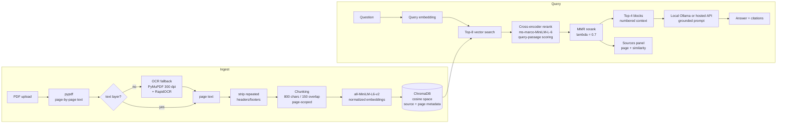

# RAG Document Assistant


-6B46C1)


A local-first Retrieval-Augmented Generation assistant for PDF documents: upload PDFs, ask questions in plain language, and get answers grounded in the documents' own text — with the page each answer came from.

Chunking and embeddings run **entirely on the local machine** (`all-MiniLM-L6-v2` via `sentence-transformers`). Only the retrieved fragments and the question are sent to the LLM.


---

## Features

- **Upload from the browser**, several PDFs at once — no CLI needed to index.
- **Scanned pages are readable** — a page without a text layer is rasterised and read with OCR (PP-OCR on ONNX runtime; no `tesseract.exe`, no model download at first use). Measured on a fully rasterised corpus: `hit@4` 0.00 → **0.96**, with 96 % of each page's words recovered.
- **Page-level citations** — every answer links to `source · page N · similarity`, with the retrieved excerpts in a collapsible panel.
- **Overlapping chunking** (800 chars / 150 overlap) cut on word boundaries, never across pages, after **stripping running headers and footers** (lines repeating on more than 40 % of a document's pages, page numbers normalised) — on a NIST standard the header repeats on 56 of 60 pages.
- **Two-stage reranking** — a cross-encoder (`ms-marco-MiniLM-L-6-v2`) re-reads each query–passage pair, then MMR picks for relevance *and* diversity. Both stages toggle independently in the UI; the candidate pool is 16 by default because stage-1 recall on the ten-document corpus is 0.828 at 8, 0.862 at 16, and going deeper to 32 lowers hit@k instead of raising it.
- **Multi-document workspace** — per-document chunk/page counts, per-document delete, document-scoped filtering (measured: scoping to the right PDF recovers two gold pages the unscoped pool never returns, hit@k 0.862 → **0.931**), one-click reset.
- **Persistent vector store** — ChromaDB on disk; the index survives restarts.
- **Grounded prompt** — the model is instructed to answer only from context and to refuse otherwise.
- **Streaming answers** — tokens appear as the model writes them, and the line under each answer reports `first token X s · complete in Y s` instead of leaving a 25-second empty box.
- **A prompt budget, measured** — each block is trimmed to the 400 characters most related to the question (sentences ranked by overlap with the question, original order kept, untouched when it already fits). Same keyword accuracy as an untrimmed prompt, ~38 % shorter prompt, first token 29.5 s → **18.3 s**; 250 chars is measurably too aggressive and is documented as such rather than shipped.
- **Measured, not guessed** — a 6-document synthetic corpus, 29 labelled questions, a 9-configuration retrieval ablation, a gold-label validator that fails the run when a rubric drifts, a **claim-level citation check** in which every cited sentence is compared with the block it names, a **5-configuration cross-lingual run** that asks the same facts in Russian and Chinese, an OCR run against a fully rasterised corpus, and a **second corpus of ten real PDFs** (2 155 pages, arXiv papers, a patent, a central-bank annual report, an IPCC chapter, a NIST standard, a government report, a bill) that shows what the synthetic fixtures could not.
- **Numbers with an interval, not a single reading** — `eval/run_variance.py` repeats the answer step three times on frozen retrieval and reports the spread plus pooled 95 % Wilson intervals.
- **A sentence-level entailment check, off by default** — each cited block is split into sentences (plus two-sentence windows, so pronouns keep their antecedent) and scored against the claim by a local NLI model; it reproduced the 25-claim manual audit exactly on the synthetic corpus and flags 6 of 29 real-corpus claims for human review. `ENTAIL_ENABLED=0`, because three of those six flags turn out to be paraphrase on real prose.
- **78 unit tests** — chunker behaviour, provider resolution, refusal detection (active and passive forms), ranking order, citation mapping, claim parsing, stage switches, per-model caching, the OCR fallback's trigger and failure path, token-stream order, boilerplate stripping, entailment sentence splitting and windows, prompt trimming and the `Sources:` layout, eval labels.

## Architecture



## How it works

1. **Extraction** — `pypdf` pulls text page by page; an unreadable page yields `""` instead of failing the job. A page with almost no text (`< 60` characters) is treated as a scan: PyMuPDF rasterises it at 300 dpi and RapidOCR reads it, and the OCR text replaces the empty layer only when it is clearly longer. A normal PDF never touches the engine, and an OCR crash never aborts an upload.
2. **Chunking** — each page is split into ~800-character windows, cut on newline/space/period so words stay intact, with 150 characters of overlap; short tails are merged into the previous chunk.
3. **Embedding** — every chunk is encoded locally with normalized 384-d vectors.
4. **Storage** — one ChromaDB collection in cosine space, ids `"{source}:{page}:{index}"`. Re-indexing deletes the document's previous chunks first, so an edited PDF cannot leave stale tails.
5. **Retrieval** — the question is embedded with the same model, 16 candidates are pulled, a cross-encoder scores each query–passage pair jointly (it is the only stage that sees the question and the passage together), then MMR (λ = 0.7) narrows them to 4. Both stages are switches; `RERANK_ENABLED=0` falls back to plain MMR order. Both checkpoints are configurable (`EMBEDDING_MODEL`, `RERANK_MODEL`) and cached per name, so swapping languages is an environment change rather than a code change.
6. **Generation** — blocks are numbered `[1]…[4]`, each trimmed to the sentences most related to the question (400 characters by default), and the file/page mapping is listed once under `Sources:` after the blocks — not glued in front of them, because a 3B model reads a leading header as part of the first sentence. The model answers only from them and cites the block numbers it used. Tokens are streamed to the UI as they are produced, and the answer line reports the first-token time, because on CPU the wait is prompt processing before the first word.

## Evaluation

### Corpus

`eval/corpus/` holds 6 synthetic PDFs, 3 pages each (18 pages, 18 chunks at 800/150). The content is deliberately adversarial for retrieval:

- every document has a "Limitations" / "notes" page with similar wording, so lexical matching alone picks the wrong file;
- several documents discuss the same concepts (chunk size, overlap, top-k, citations) and only the numbers differ;
- facts are pinned to specific pages, which is what the citation metric needs.

It is a **test fixture, not a benchmark**: the numbers are internally consistent but invented, and the point is comparing configurations against each other. A second corpus of ten genuine PDFs — 2 155 pages of arXiv papers, a patent, a central-bank annual report, an IPCC chapter, a NIST standard, a government report and a bill — is measured separately in [the real-corpus section](#a-real-corpus--ten-pdfs-nobody-wrote-for-this-project), and the gap between the two is the most useful number on this page.

### Questions

`eval/qa_set.jsonl` — 29 questions: 25 in-scope lookups spread across all 6 documents, 4 out-of-scope questions the corpus cannot answer (the only direct test of grounding). Before scoring, `validate_qa_set()` re-reads every gold page and checks that it actually contains the fact the question asks about; a mismatch aborts the run.

### Retrieval results (default config: 800/150, retrieve 8 → cross-encoder → MMR, k = 4)

| Metric | Result | What it measures |
|---|---|---|
| hit@k | **1.00** (25/25) | gold (document, page) present in the returned set |
| hit@1 | **0.96** (24/25) | the first returned chunk is the gold one |
| MRR | **0.980** | 1/rank of the first correct chunk |

The one question that is retrieved but not first (`c04`, a table-extraction question) used to be the only outright miss before the cross-encoder was added; the block is now in the window, at rank 2. `hit@k` at 1.00 means every gold page reaches the prompt — which is what makes the remaining citation problem measurable instead of hidden behind retrieval errors.

### Ablation — does the configuration actually matter?

`python eval/run_ablation.py` (retrieval only, no model-generated answers; cost is CPU only):

| Config | Chunks | hit@k | hit@1 | MRR | s/question |
|---|---|---|---|---|---|
| 500 / 0, no MMR, k=3 | 31 | 0.960 | 0.840 | 0.893 | 0.09 |
| 500 / 50, no MMR, k=3 | 34 | 0.960 | 0.840 | 0.893 | 0.03 |
| 800 / 150, no MMR, k=3 | 18 | 0.960 | 0.880 | 0.920 | 0.03 |
| 800 / 150, MMR, k=3 | 18 | 0.960 | 0.880 | 0.913 | 0.03 |
| 800 / 150, MMR, k=4 | 18 | 0.960 | 0.880 | 0.913 | 0.03 |
| 800 / 150, **CE**, k=3 | 18 | **1.000** | **0.960** | **0.980** | 4.29 ¹ |
| 800 / 150, **CE**, k=4 | 18 | **1.000** | **0.960** | **0.980** | 0.34 |
| 800 / 150, **CE + MMR**, k=3 | 18 | **1.000** | **0.960** | **0.980** | 0.33 |
| 800 / 150, **CE + MMR**, k=4 | 18 | **1.000** | **0.960** | **0.980** | 0.39 |

¹ the first CE row includes the one-time model load (~4 s); every later row is steady-state. Every configuration misses only `p04` except the CE ones, which recover it.

Four honest readings:

1. **Larger chunks won on this corpus**: 800/150 beats 500-char chunks on hit@1 (+4 points) and MRR (+0.027), with 13 fewer chunks. Longer windows keep a full paragraph together, and the answers here live inside paragraphs.
2. **Overlap did not move the ranking** at 500 chars (identical to no overlap). Overlap protects boundary recall, which hit@1 largely cannot see — it is a safety margin, not a free win.
3. **MMR cost 0.007 MRR on top of the vector stage.** It pushes the exact gold chunk slightly down in exchange for context diversity, which this metric cannot observe. It stays enabled because the prompt benefits from non-redundant blocks — but claiming it improves retrieval would be wrong.
4. **The cross-encoder is the one change that moved the ceiling**, not the margin: `hit@k` 0.96 → **1.00** (the single miss, `p04`, is recovered), `hit@1` 0.88 → **0.96**, MRR 0.913 → **0.980**. It costs ~0.3 s per query on CPU and adds no retrieval misses back. Notably, MMR applied *after* the cross-encoder costs nothing here — MMR reorders within a list the CE has already ranked correctly, and with only 8 candidates the diversity term rarely overrides a strong CE score.

Two caveats on reading the CE row: the reranker is `ms-marco`, trained on **English** MS MARCO passages, so these numbers say "it works on English text", not "it works on Chinese or Russian PDFs" — the next section measures that boundary directly. And with 25 questions, one recovered question is 4 points of `hit@1` — the direction is solid, the exact magnitude is not.

### Cross-lingual questions — the same 12 facts asked in Russian and Chinese

`eval/qa_set_multilingual.jsonl` mirrors twelve in-scope English questions into `ru` and `zh` (24 questions) against the **English** corpus, keeping the same documents and gold pages. The English `page_contains` token is kept in each row, so `validate_qa_set()` still proves every label points at text that really holds the fact — a translated question cannot silently inherit a stale rubric.

`python eval/run_multilingual.py` runs five configurations, each changing exactly one thing, retrieval only (no model-generated answers, no cost):

| Embedder | Cross-encoder | hit@4 | hit@1 | MRR | hit@4 ru | hit@4 zh | Misses | s/question |
|---|---|---|---|---|---|---|---|---|
| EN `all-MiniLM-L6` | — | 0.667 | 0.292 | 0.396 | 0.583 | 0.750 | 8 | 0.02 |
| EN `all-MiniLM-L6` | EN `ms-marco` | 0.667 | 0.500 | 0.562 | 0.583 | 0.750 | 8 | 0.40 |
| ML `paraphrase-multilingual` | — | **0.917** | 0.667 | 0.774 | 0.833 | 1.000 | 2 | 0.03 |
| ML `paraphrase-multilingual` | EN `ms-marco` | 0.792 | 0.500 | 0.622 | 0.750 | 0.833 | 5 | 0.25 |
| ML `paraphrase-multilingual` | ML `bge-reranker-base` | **0.958** | **0.875** | **0.917** | 0.917 | 1.000 | 1 | 1.55 |

Six readings, in order of how much they changed the design:

1. **A reranker cannot create candidates.** Row 1 → row 2 leaves `hit@4` at **0.667 with the same eight misses**; only `hit@1` moves (0.292 → 0.500) and MRR follows (0.396 → 0.562). The cross-encoder reorders the eight blocks the English embedder handed it and cannot pull in the page the embedder never retrieved.
2. **The embedder is the decision.** Swapping only the bi-encoder takes `hit@4` 0.667 → **0.917** and cuts misses 8 → 2. This is why the pair is measured separately instead of "we added a multilingual reranker".
3. **The wrong-language reranker is worse than none.** Multilingual candidates reordered by an English `ms-marco` score **0.792 / 0.500 / 0.622** — below row 3's 0.917 / 0.667 / 0.774, and misses go 2 → 5. The model reads a Russian or Chinese question against an English passage, prefers the wrong block, and displaces a gold chunk that plain cosine order had already placed in the window. Adding a reranker is not a monotone improvement; its language has to match the question's.
4. **Both sides multilingual** is the best row: **0.958 / 0.875 / 0.917**, which is close to the English-only ceiling (1.000 / 0.960 / 0.980) but not equal to it.
5. **The single remaining miss is MMR, not the model.** `p04-ru` (claim-by-claim verification) lands at **rank 4** after `bge-reranker-base`, then MMR's diversity term swaps it for a lower-scoring block from another document — the same trade the English ablation priced at 0.007 MRR. With MMR off it is a hit.
6. **Chinese saturates, Russian does not.** `hit@4` for `zh` is 1.000 in two of the five rows; `ru` tops out at 0.917. Only one question separates them, so the honest statement is "a consistent gap of about one question", not "Chinese is easier".

Costs: `bge-reranker-base` is 278 M parameters (XLM-RoBERTa based) and ~1.1 GB on disk against 22 M / ~90 MB for `ms-marco`, and it costs **1.55 s per query** versus 0.25 s — around six times slower, still under two seconds. This run was made on a 2-core CPU-only Linux box rather than the laptop used for the ablation above, so the two latency columns are not directly comparable and only retrieval ranks are hardware-independent.

The shipped default stays English because the corpus and the demo are English. Switching is two environment variables plus a re-index:

```bash
EMBEDDING_MODEL=sentence-transformers/paraphrase-multilingual-MiniLM-L12-v2
RERANK_MODEL=BAAI/bge-reranker-base
```

A swapped embedder invalidates the existing collection: the stored vectors came from the old model and are not comparable with the new one, so `chroma_db/` has to be rebuilt (or a fresh collection used) rather than reused.

### Scanned pages — what the OCR fallback recovers

The whole corpus is rasterised page by page into image-only PDFs (same layout, same 18 pages, no text layer) — what a scanner actually produces. `python eval/run_ocr.py` aborts if the rasterised copies still expose any text, so "scanned" cannot quietly mean "digital".

| Index | Chunks | hit@4 | hit@1 | MRR | Misses |
|---|---|---|---|---|---|
| digital (the shipped PDFs) | 18 | 1.000 | 0.960 | 0.980 | 0 |
| rasterised, no OCR | **0** | 0.000 | 0.000 | 0.000 | 25 |
| rasterised, OCR 300 dpi | 18 | **0.960** | 0.920 | 0.940 | 1 |

Readings:

1. **Without a text layer the failure is total, not gradual.** Zero chunks are written, so all 25 questions miss: there is nothing to retrieve. This is the case the fallback exists for.
2. **With OCR almost everything comes back** — 0.960 / 0.920 / 0.940, one question short of the digital ceiling. The single miss is `p02`, and the cause is visible: OCR dropped one whole line of that page (the line holding "four blocks of 800 characters ≈ 3200 tokens"). Line-level detection failures are the residual error mode, not character misreads.
3. **Page fidelity is the honest intermediate metric.** Against the digital text, the engine reproduces **96.1 %** of a page's words on average, worst page **74.8 %** (`vector-store-notes` p2). Every page above 90 % except three.
4. **300 dpi, not 150 or 200.** A pilot on one page gave 61.5 % / 83.7 % / 99.0 % word recall at 150 / 200 / 300 dpi. On the full corpus, 200 dpi reaches 95.2 % mean recall but a **57.7 %** worst page and `hit@1` 0.880 instead of 0.920. The engine rescales its input to a fixed working size, so 300 dpi cost the same wall time as 200 dpi on this laptop — the quality was free.
5. **Cost:** 4.2 s per page, 75.9 s to index the 18 scanned pages, against 32.4 s for the digital version of the same corpus (embeddings dominate both). Indexing is a one-off; a 200-page scan is ~15 minutes.

What OCR does **not** fix: layout. Tables and multi-column pages come out in detection order, so a row of numbers can be read across the wrong columns. Language coverage is the bundled PP-OCR model — Latin and Chinese; on a Russian test sentence it returned transliterated Latin (`BekTopHoe xpaHWnWue`, 5 % word recall against 94 % character recall for a Chinese line). A Cyrillic recogniser is a different model, not a tuning flag, and the README would rather say so than imply "OCR" means "every language".

### Answer-level results (local 3B model, no API account)

Generated with `LLM_PROVIDER=ollama`, `qwen2.5:3b`, temperature 0.2, no hosted calls at all, retrieval running the full cross-encoder pipeline. 29 answers, `api_errors: 0`.

The third column is the **shipped default**: cross-encoder plus a 400-character budget per block, which is the prompt change measured in the next-but-one section (`eval/reports/latest.json`). The first two columns are the earlier budget-free runs and are kept so the effect of each step stays visible.

| Metric | Before CE | With CE | **CE + 400-char budget (current default)** | What it measures |
|---|---|---|---|---|
| answer accuracy (lexical key match) | 0.92 (23/25) | 0.96 (24/25) | **1.00** (25/25) | the answer contains the fact's key token |
| answer accuracy (manual audit) | 0.96 (24/25) | 1.00 (25/25) | **1.00** (25/25) | each answer read against the gold page |
| citation rate | 1.0 (25/25) | 1.0 (25/25) | **1.0** (25/25) | every answer carries at least one `[n]` |
| **citation gold rate** | — | 0.80 (20/25) | **0.92** (23/25) | the cited `[n]` maps to the gold page |
| **claim support rate** | — | 0.80 (20/25) | **0.92** (23/25) | the cited block is the best match for the *sentence* that cites it |
| refusal rate | 1.0 (4/4) | 0.75 (3/4) | **1.00** (4/4) | out-of-scope questions are declined, not answered |

Six things worth reading before trusting these numbers:

1. **Retrieval is no longer the weak link; citation attribution is.** `citation_gold_rate` maps `[n]` back to the page of the block that was actually shown, and `claim_support_rate` goes one level further: the answer is split into sentences, and each sentence that cites a block is compared with that block — lexically and by embedding — against the other three blocks. Under the shipped default 23 of 25 pass both. The two failures are the same shape as the five from the budget-free run: the gold page was **block `[1]`, ranked first**, and the model wrote `[2]` — `e05` (768 dimensions) and `r01` (MRR 0.33). The answer text is right in both. This is textbook citation drift, the exact failure the corpus page `prompt-design.pdf` describes — and the presence-only `citation_rate` scores it 1.0.
2. **The claim check was calibrated against the manual audit, not trusted on faith.** The 29 stored answers were graded by hand first, then by the code: on the budget-free run the automatic check flagged exactly the five known drifts and none of the twenty correct answers, so the per-claim verdicts agreed with the human labels 25/25. It is still an *attribution* check, not entailment — a sentence can cite the right block and then say something the block does not support (the entailment section below is the attempt at that, and it ships switched off for a reason). The two thresholds (a 0.06 embedding margin, a 0.35 lexical-overlap floor) are stated in `src/citations.py` and can be re-tuned; `eval/claim_audit.py` re-grades stored answers without regenerating them, and per-sentence verdicts are in `eval/reports/claims.json`.
3. **The cross-encoder fixed the one answer that used to be wrong.** `p04` asks what claim-by-claim verification catches that rate-based metrics cannot; before CE the gold page never reached the prompt and the model answered "contamination". Now the page is block `[1]`, the answer names citation drift, and lexical accuracy rose 0.92 → 0.96. The remaining defect there was the citation bracket, not the content.
4. **One 3B-specific defect was caused by the prompt layout, and fixed by it.** With the file name in front of each block, `p03` answered "…is called source: prompt-design.pdf, page 3 Context dilution" — the model read the header as part of the sentence. A blank line between header and text did not help; moving the mapping into a `Sources:` list *after* the blocks did, and the same run now answers "…is called Context dilution [1]". The lesson: a header glued to text is text as far as a small model is concerned.
5. **Refusal is the number that moved for a boring reason.** The 0.75 in the middle column was a *detector* bug, not model behaviour: `o03` could not be indexed as a refusal because `REFUSAL_PATTERN` only knew the active form ("cannot find"), while the model produced the passive "cannot be found in the provided context". The pattern now covers `cannot|can't be (found|answered|determined)` and `not (found|present) in the`, with a test in `tests/test_refusal.py`, and the same stored run rescores to 1.00. This is worth stating plainly: a metric can improve without a single change to the model, and the only way to tell the difference is to read the answers.
6. **The LLM judge was tried and rejected.** The same 3B model scored 7 grounded answers as 1/5, and a controlled case scored `2` through the OpenAI-compatible shim versus `4` through Ollama's native API. An uncalibrated instrument is worse than no instrument, so the committed report carries `judge_mean_faithfulness: null` and the experiment is kept as evidence in `eval/reports/judge_experiment.json`. Per-answer verdicts are in `eval/reports/answer_audit.md`.
7. **What reproduced, and what did not.** Under the budget-free configuration the five drift answers reproduced exactly on both runs, while refusal moved 4/4 → 3/4 with no code change. The current default was run once and audited by hand (25/25 correct content, two drift brackets — `e05`, `r01`); three repeats of it are in the variance section, which is there to keep single-run numbers from being read as facts.


### Streaming — measured time to first token

`python eval/measure_stream.py` asks three questions twice: once streamed (the UI path) and once blocking (the eval path), both with the retrieval pipeline in front. Same model, same session, model already warm.

| Question | First token | Streamed total | Blocking total | Answer chars |
|---|---|---|---|---|
| `e01` | 23.8 s | 25.0 s | 25.3 s | 47 |
| `v01` | 24.9 s | 26.4 s | 26.2 s | 69 |
| `d02` | 22.6 s | 24.6 s | 24.3 s | 70 |
| mean | **23.7 s** | 25.3 s | 25.3 s | 62 |

What this says, including the part that is inconvenient:

1. **Streaming does not make the model faster.** 25.3 s streamed against 25.3 s blocking — the same wall clock, and two of three answers were byte-identical.
2. **It only hides about 1.6 s.** The first token arrives at 23.7 s of a 25.3 s answer. On CPU the wait is prompt prefill (~900 tokens of numbered context), not token generation (~20 tokens of answer). Streaming therefore fixes the *impression* of a freeze; it does not fix the latency, and the README should not pretend otherwise.
3. **The real lever is the prompt, not the transport.** Fewer blocks (`Chunks sent to the model` in the sidebar), smaller chunks, or a faster backend. The next section measures the first of those; a hosted model answers in 1–3 s on the same code path.
4. **Cache makes a fake 8× speedup easy to publish.** Ollama caches the longest common prefix: measured naively, the blocking call after a streamed one returns in 1.3–1.7 s because the whole context is already processed. The script puts a marker in the *first* context block so both modes are cold; a marker at the end of the question changes nothing and yields a number that measures the cache.
5. **Latency is one-run data, and the spread shows why that matters.** The answer-level audit above measured **46.7 s** per question (retrieval + generation, 60.6 s max) for the same pipeline and model, this run **25.3 s** — a 1.8× difference between two sessions on one laptop with no code change. Retrieval alone, cross-encoder included, is 0.3–0.4 s per question. Retrieval ranks are stable across runs; wall-clock times are not, which is what the variance section below measures instead of guessing.

### Prompt budget — cutting the prefill instead of the model

The streaming section says the wait is prompt prefill: ~900 tokens of numbered context processed before one answer token is emitted. So the cheapest latency gain is not a faster model, it is a shorter prompt. `python eval/measure_prompt.py --budgets 0,400,250` keeps retrieval frozen for three questions and only changes how many characters of each block reach the model. `src/generation.trim_block` drops the sentences least related to the question first, keeps the surviving sentences in their original order, and leaves a block untouched when it already fits.

| Budget (chars per block) | Prompt chars | First token | Full answer | keyword accuracy |
|---|---|---|---|---|
| 0 (no trimming) | 2756 | 29.5 s | 31.3 s | 1.0 |
| **400 (shipped default)** | 1794 | **18.3 s** | 19.9 s | 1.0 |
| 250 | 1178 | 12.9 s | 14.9 s | 1.0 |

Four readings:

1. **It is close to linear in prompt length, at ~10.7 ms per character.** The three points above are 2756/1794/1178 characters and 29.5/18.3/12.9 s to first token — a 57 % prompt cut buys a 56 % wait cut, on this laptop, in this session. That slope is the single most useful number in this README for anyone running the same model on CPU: it converts "make the prompt shorter" from advice into arithmetic.
2. **The 250-char budget is where quality breaks, and it breaks in a specific place.** Same 25 questions, `CONTEXT_BUDGET` set per run: 250 chars keeps 0.96 citation-gold but drops lexical accuracy to **0.80** and refusal to **0.50** — the sentences holding the numbers get trimmed away, and an answer without the fact still looks fluent. 400 keeps lexical accuracy intact and *raises* citation gold and claim support, so it is the shipped default; the same quality table, with the budget-free run as the baseline, is `eval/reports/latest_budget0.json`, `latest_budget250*.json`, `eval/reports/latest.json`.
3. **Caching will happily fabricate a speedup for you.** Ollama reuses the longest common prefix of a prompt, so a "cold" measurement that shares its opening blocks with a warmup run returns in 0.2–2.2 s. This cost two wrong tables before I moved the warmup to a question that is not in the measured set, contexts included. If a latency number looks 8× better than its neighbours, the first hypothesis is the cache, not the code.
4. **What this does not fix.** Prefill still dominates: 18 s of a 20 s answer under the default. Trimming buys time inside the current model, and the honest summary is "four times less waiting than the worst case here, still not interactive on CPU". A hosted model, or a smaller context (`Chunks sent to the model = 2`), is the next lever, and both are one config value away.

### A real corpus — ten PDFs nobody wrote for this project

The synthetic corpus is friendly by construction: one idea per page, prose in a simple layout, no running headers. `eval/real_corpus/` holds ten genuine documents instead — downloaded by `eval/fetch_real_corpus.py` (sha256-checked, **not committed**: they belong to their authors) and scored by `eval/run_real.py`:

| Document | Source | Why it is here | Pages used |
|---|---|---|---|
| `attention.pdf` | arXiv 1706.03762 | single column, tables and footnotes | 15 / 15 |
| `rag.pdf` | arXiv 2005.11401 | two column, dense related-work prose | 19 / 19 |
| `bert.pdf` | arXiv 1810.04805 | two column, many tables and ablations | 16 / 16 |
| `nist-800-63b.pdf` | NIST SP 800-63B | numbered clauses, running header on 56 of 60 pages | 60 / 80 |
| `gpo-911.pdf` | GPO 9/11 report | photographic pages, captions, footnotes | 60 / 585 |
| `bills-hr3684.pdf` | US bill HR 3684 | legislative text, dense cross-references, no prose | 60 / 1039 |
| `patent-us9600411.pdf` | US patent 9,600,411 B2 | claims, numbered paragraphs, figure sheets with almost no text | 31 / 31 |
| `fed-annual-2023.pdf` | Federal Reserve 2023 annual report | financial prose with tables split across pages | 60 / 222 |
| `ipcc-ar6-ch3.pdf` | IPCC AR6 WG1 chapter 3 | figure captions, cross-chapter references, 30 MB of dense typesetting | 60 / 130 |
| `dropout-2012.pdf` | arXiv 1207.0580 | older single-column preprint, heavy notation, experiment tables | 18 / 18 |

2 155 pages in the files; the first 60 pages of each document are indexed (399 pages, 2 063 chunks). The cap is deliberate — the open question is layout and boilerplate, not scale, and 399 pages of real typesetting already make a 384-d vector search feel different from 18 synthetic pages.

Two of the ten needed the OCR path on real input, which is the first time that happened outside the rasterised fixture: `patent-us9600411.pdf` spent 8 of its 31 pages under OCR (figure sheets carry reference numerals, not prose) and `ipcc-ar6-ch3.pdf` sent one page to OCR after its text layer refused to parse.

`eval/qa_set_real.jsonl` — 30 questions (29 in scope, 1 the corpus cannot answer), every gold page checked by the same `validate_qa_set()` used everywhere else. Shipped defaults (retrieve 16 → cross-encoder → MMR, k = 4, boilerplate stripped, `qwen2.5:3b`):

| Metric | Real corpus (10 docs) | Real corpus, first six docs | Synthetic corpus |
|---|---|---|---|
| hit@k | **0.862** (25/29) | 0.889 (16/18) | 1.00 (25/25) |
| hit@1 | **0.759** (22/29) | 0.722 (13/18) | 0.96 (24/25) |
| MRR | **0.799** | 0.796 | 0.980 |
| answer keyword accuracy | **0.793** (23/29) | 0.722 (13/18) | 0.96 (24/25) |
| citation rate (some `[n]`) | **1.0** (29/29) | 1.0 (18/18) | 1.0 (25/25) |
| **citation gold rate** | **0.724** (21/29) | 0.556 (10/18) | 0.80 (20/25) |
| claim support rate | **1.0** | 0.941 | 0.80 |
| refusal (out-of-scope) | **1.0** (1/1) | 1.0 (1/1) | 0.75 (3/4) |

Five readings:

1. **Four documents cost three points of hit@k, and only one of the four misses is a new question.** `a_r4` (an affiliation printed on page 1) and `b_r1` ("section 5.3", a pointer to a place rather than a sentence about a fact) still miss. `d_r1` asks for a paper's *title* — topical blocks outrank the title page. The interesting one is `b_r2`: it was a hit on six documents, and on ten it no longer even reaches the sixteen candidates, although neither its question nor its gold appendix page changed — the depth sweep below pins its chunk at vector rank 19, so widening the corpus changed what stands between that page and the query. A retrieval score is a property of the corpus as much as of the pipeline.
2. **The answer layer moved in this run, and that is the least trustworthy row in the table.** Keyword accuracy 0.722 → 0.793, citation gold 0.556 → **0.724**, claim support 0.941 → 1.0 on the same model and prompt. Two runs over different corpora are not a trend: the variance section below shows answer-side ratios moving (citation gold 0.800 on all three runs, Wilson 0.696–0.875) even when retrieval is frozen. Read the citation gold rate as "roughly three quarters of answers cite the block the gold page is in", not as a gain over the previous section.
3. **The OCR fallback earned its keep on real input, and found a case it cannot fix.** `patent-us9600411.pdf` sent 8 of its 31 pages to OCR (figure sheets carry reference numerals, not prose) and `ipcc-ar6-ch3.pdf` sent one page whose text layer refused to parse at all. The patent also shows the other failure mode: its front page extracts as `Assignee: ths latworks Inc.` — the text layer is present, so OCR never fires, and the name is simply wrong. OCR recovers a missing layer; it does not repair a garbled one.
4. **Boilerplate stripping catches a second header, at half the pages.** Beyond the NIST header (56 of 60 pages, 1.66 % of characters), the patent repeats `US 9,600,411 B2` on 16 of 31 pages and it is stripped at the 40 % threshold. Across the ten documents that footing changes little in absolute terms — 2 063 chunks are indexed — but it keeps the patent's claim pages from starting with a bare patent number.
5. **What the corpus still does not say.** Twenty-nine questions read by one person, ten documents, a 60-page cap (the patent is 31 pages, the Fed report 222, the IPCC chapter 130, the bill 1 039). It is enough to show the four failure modes above; it is not enough to quote as "the accuracy of this pipeline". No Cyrillic document made it into the corpus — the Russian EUR-Lex PDF endpoint returns 404 from this network and the RFC PDF endpoints 500/403, so the non-Latin-script case is still unmeasured, and `gpo-911` still contributes one 28-character "chunk" from an image-heavy page, which is why `MIN_CHUNK_CHARS` matters on real layouts. The out-of-scope probe also had to change: it used to ask for an overnight Federal Reserve lending rate, which was unanswerable from six documents and became *nearly* answerable once the Fed report joined the corpus (the model replied with an ON RRP paragraph instead of refusing). It is now a question no document covers. Widening a corpus silently changes which questions are unanswerable, which is the sort of drift the validator catches for gold pages and nothing catches for probes.

`RETRIEVE_K = 16` came from the depth sweep on the six-document stage, and the ten-document re-run below now explains the misses instead of leaving the question open. Stage-1 recall (vector stage alone, before the cross-encoder) at cutoffs 8 / 16 / 32 / 64 is **0.828 / 0.862 / 0.931 / 0.966** on 29 questions, and the candidate that enters at 32 does not survive the pipeline:

| Configuration (k = 4) | hit@k | hit@1 | MRR | Misses |
|---|---|---|---|---|
| retrieve 8, cross-encoder **off** | 0.759 | 0.517 | 0.621 | 7 |
| retrieve 8, cross-encoder on | 0.793 | 0.759 | 0.770 | `a_r4` `b_r1` `b_r2` `n_r1` `i_r2` `d_r1` |
| **retrieve 16, cross-encoder on** | **0.862** | **0.759** | **0.799** | `a_r4` `b_r1` `b_r2` `d_r1` |
| retrieve 32, cross-encoder on | 0.828 | 0.759 | 0.787 | `a_r4` `b_r1` `r_r1` `p_r3` `d_r1` |
| retrieve 32, cross-encoder **off** | 0.690 | 0.517 | 0.603 | 9 |

Three readings:

1. **Past 16, more depth makes it worse, and the mechanism is MMR's four slots.** Stage-1 recall rises monotonically (0.828 → 0.966) while hit@k peaks at 16 and *falls* at 32, and hit@1 does not move at all with the cross-encoder (0.759 in all three runs). The deeper candidates are near-duplicates of the first sixteen: they enter the diversity window, and at 32 they push out `r_r1` and `p_r3` — whose gold chunks rank 1st and 3rd by embedding similarity — while `n_r1` and `i_r2` (ranks 7 and 9, inside the pool at 16) are dropped. Without the cross-encoder the effect is starker: 0.759 at 8 against 0.690 at 32.
2. **The misses split by rank, which is what the sweep was built to answer.** `a_r4` (18), `b_r2` (19) and `b_r1` (64) never enter the sixteen-candidate pool — and this is the explanation for `b_r2`'s regression: same question, same gold appendix page, but its chunk now ranks 19th against a corpus of 2 063. `n_r1` (7) and `i_r2` (9) did enter and were pushed out by reranker plus MMR. `d_r1` is **not in the top 64 at all** (`rank: null`), which fits its question: asking for a paper's title asks about the document, not about a sentence in it.
3. **The cross-encoder is worth more than the depth.** At retrieve 8 it buys +0.034 hit@k, +0.242 hit@1 and +0.149 MRR over no reranker; going from 8 to 16 candidates buys another +0.069 hit@k; going to 32 buys nothing. That is the argument for keeping `RETRIEVE_K = 16` rather than doubling it, and it is a measurement now, not an extrapolation from the six-document stage (`eval/reports/real_depth.json`; the six-document baseline is kept as `real_depth_six.json`).

### Document-scoped questions — does the filter help, and how much?

The sidebar lets a user scope a question to one PDF, and `DocumentStore.query` passes that to Chroma as a `sources` filter. `python eval/run_real_filter.py` measures it on the real corpus, in the honest version: the filter is set to the document the answer really comes from. That is what a user who knows where to look gets, and it is an **upper bound** — filtering on the wrong document returns nothing from the right one, by definition, so a wrong guess is a guaranteed miss.

| Mode | stage-1 recall | hit@4 | hit@1 | MRR | misses | s/question |
|---|---|---|---|---|---|---|
| no filter | 0.862 | 0.862 | 0.759 | 0.799 | 4 | 1.01 |
| document-scoped | **0.931** | **0.931** | **0.793** | **0.851** | 2 | 0.69 |

Three readings:

1. **On ten documents the filter does move stage 1, and that corrects a claim the six-document run supported.** Stage-1 recall goes 0.862 → 0.931: with four more documents the sixteen-candidate pool is crowded enough that two gold pages (`a_r4`, `b_r2`) never enter it unscoped, and a one-document pool lets them in. On the six-document corpus the same experiment showed 0.944 in both modes, which is where the earlier "the filter changes the competition, not what the index can find" reading came from. It was true at that size and it is not true here — the honest version is that how much the filter buys depends on how crowded the pool is.
2. **It recovers `a_r4` and `b_r2`, and still leaves `b_r1` and `d_r1`.** `a_r4` (an affiliation printed on page 1) and `b_r2` (an appendix pointer) were losing to other documents' blocks; scoping removes those. `b_r1` ("section 5.3") still misses inside `bert` alone, so its problem is the question's form, not the corpus size. `d_r1` is the surprise: it asks for the *title* of the paper and misses even with only `dropout-2012` in the pool — the cross-encoder prefers pages that discuss dropout over the title page that merely names the paper. A filter cannot fix a question about the document itself.
3. **It is also cheaper: 0.69 s per question against 1.01.** Both the vector scan and the cross-encoder work on a smaller pool, so a user who knows which document to ask about gets a better answer, faster.

### Variance — how much do the numbers move between identical runs?

Every answer-level number above was measured once. `python eval/run_variance.py --runs 3` repeats the answer step three times on the same 25 synthetic questions with retrieval **frozen** (the same four blocks for every run), so any spread is the sampler, not the index. The table below is the shipped default — cross-encoder plus the 400-character budget — and `eval/reports/variance.json`; the budget-free archive is `variance_budget0.json`.

| Run | keyword accuracy | citation rate | citation gold rate | claim support | mean answer chars | 25 answers |
|---|---|---|---|---|---|---|
| 1 | 1.000 | 1.000 | 0.920 | 0.920 | 91.2 | 572.7 s |
| 2 | 1.000 | 1.000 | 0.920 | 0.920 | 91.0 | 564.0 s |
| 3 | 1.000 | 1.000 | 0.920 | 0.920 | 93.3 | 577.7 s |
| mean ± sd | 1.000 ± 0 | 1.000 ± 0 | 0.920 ± 0 | 0.920 ± 0 | 91.8 ± 1.3 | 22.9 s/question |

Pooled over the 75 answers (three runs × 25), with 95 % Wilson intervals — Wilson rather than the normal approximation because these rates sit close to the boundaries:

| Metric | Pooled | 95 % interval |
|---|---|---|
| keyword accuracy | 1.000 (75/75) | 0.951 – 1.000 |
| citation rate | 1.000 (75/75) | 0.951 – 1.000 |
| citation gold rate | 0.920 (69/75) | 0.836 – 0.963 |

Five readings:

1. **Retrieval was frozen, so the spread here is generation only.** `retrieval_stable: true` in the report means the same four blocks were handed to the model in all three runs; retrieval numbers move when the index or the configuration moves, and they did not wobble at all across these repeats.
2. **Nothing moved.** All four answer metrics are identical in all three runs, no question changed verdict between runs, and the same two drift answers (`e05`, `r01`) appear every time. That reproducibility is what makes `citation_gold_rate` publishable: a metric whose failures reshuffle between runs would be measuring the sampler, not the pipeline. The budget-free configuration was less stable — its three runs read 0.920 / 0.920 / 0.960, with `p02` flipping between runs — which is one more reason the shorter prompt is the shipped one, although the format change and the budget change happened in the same week.
3. **The two failures are the same failure every run.** `e05` ("what dimensionality does bge-base-en-v1.5 produce") answers `768 [2]` while the gold page is block `[1]`; `r01` ("what MRR does a correct answer at position 3 get") answers `0.33 [2]` with the gold at `[1]`. Both are content-correct and bracket-wrong, and three repeats buy nothing: this is a model behaviour, not noise.
4. **The interval is the honest headline.** On 25 questions, "0.92" means 0.84–0.96 and "1.00" means 0.95–1.00. Any answer-level number from this project should be quoted with its interval, or at least as a direction.
5. **Latency is stable inside a session, and one earlier number was not real.** Three repeats of the same 25 questions took 572.7 / 564.0 / 577.7 s — 22.9 s each, under 1.2 % spread. An earlier three-run batch was thrown away because run 2 reported 3207 s: the machine slept mid-run, and a wall clock that includes a suspend is not a latency measurement. The 1.8× gap quoted in the streaming section (46.7 s vs 25.3 s) is between sessions — machine state and prompt length — not sampler noise.

What this does **not** cover: the real corpus (29 in-scope questions, one run), any change of retrieval configuration, and the temperature-0.2 sampler's effect on wording beyond the questions observed here.

Each run indexes into a throwaway store, so results never depend on your working collection. Reports land in `eval/reports/`.

```powershell
python eval/run_eval.py                     # retrieval + answers + citation/claim metrics
python eval/run_eval.py --judge             # add LLM judging (reliable only with a hosted model)
python eval/run_eval.py --no-answers        # retrieval only, no model calls
python eval/run_eval.py --no-ce             # retrieval ablation without the cross-encoder
python eval/run_eval.py --rescore eval/reports/latest.json   # re-score stored answers, no model calls
python eval/claim_audit.py                  # per-sentence citation verdicts for the stored answers
python eval/run_multilingual.py             # 5-configuration cross-lingual retrieval
python eval/run_ocr.py                      # rasterise the corpus, measure what OCR recovers
python eval/measure_stream.py               # time to first token vs total, streamed vs blocking
python eval/measure_prompt.py --budgets 0,400,250   # same retrieval, three prompt budgets, timed
python eval/fetch_real_corpus.py            # download the 10 real PDFs once (sha256-checked, not committed)
python eval/run_real.py                     # retrieval + answers on the real corpus
python eval/sweep_real_depth.py             # RETRIEVE_K 8/16/32 x cross-encoder on/off (ten documents)
python eval/run_variance.py --runs 3        # repeat the answer step, report spread + Wilson intervals
python eval/run_real_filter.py              # document-scoped vs unscoped retrieval on the real corpus
python eval/entail_calibrate.py             # NLI threshold sweep on the 25 hand-audited claims
python eval/entail_real.py                  # out-of-sample entailment flags on the real corpus
```

### Entailment — does the cited block actually *say* it?

`claim_support_rate` answers an attribution question: is the block a sentence cites the best match for that sentence among the four blocks in the prompt. A sentence can pass it, name the right block, and then assert something the block never says — the answer's own invention, wearing a citation as a badge. This section measures that gap with a sentence-level NLI model, and reports what it took to make the number mean anything.

Two details carry the whole result. First, **the premise is split into sentences and the claim is entailed if any of them entails it** (max-pooling): a 800-character chunk handed to a sentence-pair model reads as `neutral` even when the fact is inside it. Second, **every sentence is also scored together with the sentence after it**, because a supporting sentence is often not self-contained — "the defaults are M=16" does not name ChromaDB, and "it hides how far down the answer was" replaces `hit@k` with a pronoun. Sentences that talk about the answer rather than the document ("the title is not mentioned in the provided context") are skipped: no block can entail them, so scoring them only manufactures an accusation.

The first two calibrations failed, and the failure was in the harness, not in the model:

| Attempt | Model | Best accuracy | Drifts rejected | Correct sentences wrongly accused |
|---|---|---|---|---|
| premise split on newlines | `cross-encoder/nli-MiniLM2-L6-H768` | 0.64 @ 0.10 | 5/5 | **9/20** |
| same, stronger checkpoint | `cross-encoder/nli-deberta-v3-small` | 0.52 @ 0.15 | 5/5 | **12/20** |

A bigger model made it worse, which was the clue. The chunk text in this corpus is hard-wrapped at about 60 characters, so splitting on newlines handed the model fragments: `reaches 59.8 and bge-small-en-v1.5 reaches 62.2.` arrived without a subject, and `The models are not equal on the MTEB retrieval average:` had its number cut off by the colon split. The model was answering `neutral` correctly to a broken premise. One probe made it obvious — fed proper sentences, the *same* MiniLM scored 0.973 on a verbatim pair, 0.987 on a paraphrase ("scores 62.2 on MTEB retrieval"), and 0.831 on "rank 3 gets MRR 0.33".

After normalising whitespace, splitting only on `.!?`, and adding the two-sentence windows:

| Calibration | Threshold | Accuracy | Drifts rejected | Correct kept | Weakest supported | Strongest drifted |
|---|---|---|---|---|---|---|
| 25 hand-audited claims | **0.35** | **1.00** | 5/5 | 20/20 | 0.541 (`v04`) | 0.144 (`p04`) |

Accuracy is 1.00 for every threshold between 0.15 and 0.50, so the value inside that plateau changes nothing and only the margin does. The shipped default is the **middle of the plateau** (0.35), not its upper edge: picking 0.50 because it has "the highest threshold with full accuracy" leaves the operating point one hard sentence away from the weakest supported claim. `eval/entail_calibrate.py` implements that rule, and `ENTAIL_ENABLED` is still `0` — the check runs when asked, it does not gate the pipeline.

**Out of sample, on the ten-document corpus, the picture changes.** `eval/entail_real.py` replays retrieval for the 27 stored answers (all 27 replayed identically), skips meta sentences, and scores 29 claims: **23 supported, 6 flagged**. Reading all six against the block they cite:

| Question | Score | Does the cited block say it? | What happened |
|---|---|---|---|
| `a_r3` | 0.026 | **yes** — "In this work we employ h = 8 parallel attention layers, or heads. For each of these we use dk = dv = dmodel/h = 64" | paraphrase with numbers → false accusation |
| `g_r3` | 0.227 | **yes** — "They arrived at 9:25 and established a combat air patrol (CAP) over the city" | pronoun subject inside the window → false accusation |
| `g_r1` | 0.299 | partly — source says "the alleged hijacker 5 miles away had been a medevac helicopter", the claim says "the aircraft" | subject swapped; conservative, arguable either way |
| `g_r2` | 0.005 | partly — the passenger sentence is verbatim, "The plane took off at 7:59" is in the next chunk | hyphenated line break (`includ- ing`) plus a fact outside the block |
| `r_r1` | 0.115 | **no** — the block has "RAG-Token can be seen as a standard autoregressive seq2seq generator", not "marginalizes over documents" | correct flag |
| `d_r3` | 0.013 | **no** — the block opens mid-sentence at "days with dropout…", the 90-minute figure is in the previous chunk | correct flag |

So the honest summary is three-part: on the synthetic corpus the check reproduces the hand audit exactly, but its claims are near-verbatim restatements of sentences that sit inside the cited block; on real prose, where answers paraphrase and fold enumerated clauses into one sentence, **three of six accusations are wrong** and two of the six are real. That makes it usable as a **review queue** — it surfaced two "the block does not say this" cases that the lexical check had scored 1.0 — and not usable as an automatic gate. A reviewer dismisses the false ones in seconds because they are paraphrase, not fabrication. Raising the threshold would silence them and also silence `p04`, which is exactly the sentence drift the metric exists to find.

```powershell
python eval/entail_calibrate.py            # threshold sweep against the 25 hand-audited claims
python eval/entail_calibrate.py --model <checkpoint>   # same harness, another NLI model
python eval/entail_real.py                 # out-of-sample: score real-corpus claims, list the flags
```

Reports: `eval/reports/entailment.json` (calibration, per-pair scores), `eval/reports/entail_real.json` (real-corpus flags with the cited block text).

## Tech stack

| Layer | Choice |
|---|---|
| UI | Streamlit |
| PDF parsing | pypdf |
| Boilerplate | `src/clean.py` — repeated edge lines across pages, digits normalised |
| Embeddings | sentence-transformers `all-MiniLM-L6-v2` (local, CPU) |
| Vector store | ChromaDB (`PersistentClient`, cosine space) |
| Reranking | cross-encoder `ms-marco-MiniLM-L-6-v2` + MMR over candidate embeddings (numpy) |
| OCR fallback | PyMuPDF raster + RapidOCR (PP-OCR on ONNX runtime, offline, no system binary) |
| LLM | provider-agnostic: any OpenAI-compatible endpoint, or local Ollama; answers streamed |
| Corpus fixtures | reportlab (dev only) |
| Tests | pytest |

## Quick start

**Prerequisites:** Python 3.11+. A hosted API key is optional — the default backend is a local Ollama model, which needs no account, no card and no network once the model is pulled.

```powershell
python -m venv venv
.\venv\Scripts\Activate.ps1
pip install -r requirements.txt
```

Create `.env` (git-ignored) — or copy `.env.example`:

```ini
# Offline: no key at all
LLM_PROVIDER=ollama
LLM_MODEL=qwen2.5:3b

# Or a hosted endpoint (same code, one .env edit)
# LLM_PROVIDER=dashscope
# QWEN_API_KEY=sk-your-key-here
# LLM_MODEL=qwen-plus
```

Launch the web UI:

```powershell
streamlit run ui.py
```

Streamlit opens `http://localhost:8501`. Drop PDFs into the sidebar → **Process documents** → ask questions.

> `pip install` and Hugging Face model downloads go through `hf-mirror.com` by default (set in `config.py`), because the upstream endpoint is often unreachable from mainland China.

### Generation backend

`src/config.py:resolve_llm` picks the endpoint from the environment, so the same pipeline runs against a vendor API, a self-hosted proxy or a local model. Presets: `ollama`, `dashscope`, `deepseek`, `moonshot`, `zhipu`, `openai`; every field is overridable with `LLM_BASE_URL`, `LLM_MODEL`, `LLM_API_KEY`.

Two things that are easy to get wrong, and are therefore tested in `tests/test_config.py`:

- legacy `QWEN_*` variables are honoured **only** for `dashscope` — otherwise a leftover `QWEN_BASE_URL` silently redirects a local client to a paid endpoint;
- local inference gets a longer timeout and a capped `LLM_MAX_TOKENS`, because a 3B model on CPU does not answer in three seconds.

> Hosted-endpoint failure modes: `404 Model not exist` means the endpoint does not serve that model; `400 Access denied — overdue payment` means the account balance is negative. In both cases indexing and retrieval keep working — embeddings are local — so the app degrades to a citation browser instead of dying.

### CLI

```powershell
python app.py                    # index every PDF in data/
python app.py data/real.pdf      # index one file
python query.py                  # interactive Q&A with citations
python query.py --k 6 --source real.pdf
```

### Tests and evaluation

```powershell
pip install -r requirements-dev.txt
pytest -q                        # 53 tests
python eval/build_corpus.py      # regenerate the corpus PDFs
python eval/run_ablation.py      # config comparison, no API cost
```

## Project structure

```
rag-document-assistant/
├── src/
│   ├── config.py        # env loading, paths, defaults, LLM provider resolution
│   ├── chunking.py      # page-aware overlapping windows, short-tail merging
│   ├── embeddings.py    # SentenceTransformer cache keyed by model name, normalized vectors
│   ├── store.py         # ChromaDB layer: upsert, delete-by-source, cosine query
│   ├── rerank.py        # per-model cross-encoder cache, min-max normalized scores
│   ├── retrieval.py     # vector search → cross-encoder → MMR
│   ├── citations.py     # sentence-level citation attribution checks
│   ├── entailment.py    # sentence-level NLI: does the cited block actually say this?
│   ├── generation.py    # prompt assembly, vendor-neutral client, retry/backoff, token streaming
│   ├── ingest.py        # PDF -> pages (with OCR fallback) -> boilerplate strip -> chunks -> embeddings -> store
│   ├── ocr.py           # scanned-page fallback: PyMuPDF raster + RapidOCR, lazy engine
│   └── clean.py         # running headers/footers: repeated edge-line detection, digits normalised
├── ui.py                # Streamlit app (upload, chat, citations, settings)
├── query.py             # interactive CLI
├── app.py               # CLI ingestion
├── eval/
│   ├── corpus_source.py # content of the 6 synthetic documents
│   ├── build_corpus.py  # renders corpus_source.py into PDFs
│   ├── corpus/          # generated PDFs (committed, ~4 KB each)
│   ├── qa_set.jsonl     # 29 questions with doc + page gold labels
│   ├── qa_set_multilingual.jsonl # the same 12 facts asked in ru and zh
│   ├── run_eval.py      # validation, hit@k, hit@1, MRR, answer + citation + claim metrics, --rescore
│   ├── run_ablation.py  # 9-configuration retrieval comparison with per-question latency
│   ├── run_multilingual.py # 5-configuration cross-lingual retrieval comparison
│   ├── run_ocr.py       # rasterise the corpus and measure what OCR recovers
│   ├── measure_stream.py # time to first token vs total, streamed vs blocking
│   ├── measure_prompt.py # three prompt budgets on frozen retrieval: chars, first token, total, accuracy
│   ├── claim_audit.py   # per-sentence citation verdicts against the stored answers
│   ├── entail_calibrate.py  # NLI threshold sweep against the 25 hand-audited claims
│   ├── entail_real.py   # out-of-sample entailment flags on the real corpus
│   ├── fetch_real_corpus.py # download the 10 real PDFs, verified by sha256 (not committed)
│   ├── real_corpus_manifest.json # what was downloaded, from where, and why
│   ├── qa_set_real.jsonl # 30 questions on the real documents (29 answerable + 1 probe)
│   ├── run_real.py      # retrieval + answers + boilerplate report on the real corpus
│   ├── run_variance.py  # repeat the answer step on frozen retrieval, report spread + Wilson intervals
│   ├── sweep_real_depth.py # RETRIEVE_K 8/16/32 x cross-encoder on/off on the real corpus
│   ├── run_real_filter.py # document-scoped vs unscoped retrieval, same questions
│   └── reports/         # latest.json, ablation.json, multilingual.json, ocr.json, streaming.json, prompt_budget.json, latest_budget0.json, latest_budget250*.json, latest_budget400*.json, real_corpus.json, real_depth*.json, real_filter.json, variance.json, variance_budget0.json, claims.json, answer_audit.md, judge_experiment.json, entailment.json, entail_real.json
├── tests/
│   ├── test_chunking.py    # 8 cases
│   ├── test_config.py      # 5 cases (provider resolution, legacy-env traps)
│   ├── test_refusal.py     # 6 cases (refusal detection across phrasings)
│   ├── test_retrieval_stages.py # 6 cases (rerank-score ordering, citation mapping)
│   ├── test_retrieval_switches.py # 3 cases (stage flags actually skip their stage)
│   ├── test_citations.py   # 9 cases (sentence parsing, attribution verdicts)
│   ├── test_entailment.py  # 12 cases (sentence split, windows, label order, meta claims)
│   ├── test_model_selection.py # 2 cases (per-model caches actually swap models)
│   ├── test_ocr.py         # 6 cases (OCR trigger, replacement rule, failure path)
│   ├── test_streaming.py   # 3 cases (token order, prompt content, no double generation)
│   ├── test_prompt_budget.py # 6 cases (budget 0 keeps a block whole, irrelevant sentences dropped, order kept, Sources list layout)
│   ├── test_clean.py       # 6 cases (repeated edge lines, digit normalisation, thresholds)
│   └── test_eval_labels.py # 5 cases
├── data/                # source PDFs (git-ignored)
├── chroma_db/           # persisted vector store (git-ignored)
└── docs/demo.png
```

## Design decisions

- **Page-scoped chunks over "perfect" chunks.** Chunks never cross a page boundary, which costs a little context on pages that continue mid-sentence but guarantees every citation carries a real page number.
- **Fixed windows + overlap, not semantic splitting.** At this corpus size the simplest approach is also the one that is easy to unit-test; a semantic splitter can be swapped in behind the same interface.
- **MMR, priced honestly.** It trades a little retrieval precision for context diversity; the ablation shows the price (0.007 MRR) when it runs directly on cosine scores. The value is in the prompt, and the README says so instead of pretending the retrieval metric improved.
- **Cross-encoder before diversity.** A bi-encoder embeds the question and the chunk separately, so it can only compare two summaries of meaning; a cross-encoder reads them together and is strictly better at ordering. It is the last stage to run *before* MMR, so the diversity pass reorders an already-correct list rather than rescuing a wrong one. Scores are min-max normalized into `rerank_score` and kept separate from the cosine `score`, so the UI still shows a number that is comparable across queries.
- **Delete-then-upsert.** Positional ids (`doc_0`, `doc_1`, …) break on the second document; per-source ids plus delete-first ingest make re-indexing idempotent.
- **An embedder and a reranker are a pair, not two separate features.** The embedder decides which candidates exist, the reranker only orders them; measured cross-lingually, swapping the reranker alone changed `hit@4` by exactly zero. So the two are swapped and reported together, and each model is cached **by name** (a dict in `embeddings.py`, `lru_cache(maxsize=4)` in `rerank.py`) — a single-slot cache would quietly serve the previous checkpoint and every number after that would belong to the wrong model.
- **Labels are validated, not trusted.** Every eval run re-reads the gold pages and refuses to score if a label no longer matches the document.
- **Metrics are audited before they are published.** A metric that scores clearly correct answers as failures gets fixed or removed, not reported. That is why the judge is null and the refusal detector has a negation fallback.
- **Latency work happens on the prompt, and it is measured against a frozen index.** Trimming is the only lever that costs nothing and needs no new model, so `eval/measure_prompt.py` changes one variable at a time and a budget only ships if a full 25-question run keeps its accuracy. 250 chars is the counter-example that stayed in the README instead of being quietly deleted.
- **File/page metadata goes behind the text, not in front of it.** A prompt like `[1] source: x.pdf, page 3\n\n<text>` is read by a 3B model as one sentence; the mapping moved to a `Sources:` list after the blocks, which fixed the only remaining answer-level defect caused by the prompt itself.
- **Local embeddings.** Indexing stays free and offline; the 18-page corpus indexes in seconds on CPU.
- **Provider-agnostic generation.** The same pipeline runs on a hosted API or a local model; the vendor is a config value, and the offline path needs no account or card.

## Limitations & roadmap

- **The synthetic corpus is a fixture, and the real one is small.** Six documents written to stress retrieval by design are good for comparing configurations and useless as a claim about real-world libraries; the ten real PDFs offset that but stop at 399 indexed pages and 29 questions read by one person.
- **29 in-scope questions cannot pin a rate down.** Even after three repeated runs the Wilson interval on a 25-question set is about ±15 points; the variance section reports the spread instead of hiding it, but a portfolio number should be read as a direction, not a measurement.
- **Entailment is measured, and it is conservative.** The NLI check reproduces the 25-claim hand audit (1.00) — but those claims are near-verbatim restatements, and on real-prose answers three of six flags are paraphrase rather than fabrication. It is therefore a review queue with `ENTAIL_ENABLED=0`, not a pass/fail gate, and the README says so with the six flags printed. The calibration is also **in-sample**: the 0.35 threshold was chosen on the same 25 pairs it is scored on, so the 1.00 describes that set, not the world. A checkpoint trained on technical prose, or a cross-encoder reading the claim against the whole block, would be the next thing to try.
- **The faithfulness judge needs a stronger model.** A 3B judge is uncalibrated and was rejected; the metric returns only when judging runs on a hosted model.
- **Local generation is slow, even with the prompt trimmed.** 18.3 s to first token and 19.9 s to a full answer on CPU under the shipped default, against 29.5 s untrimmed. Fast enough to prove the pipeline works offline, not fast enough to feel interactive; the remaining lever is a hosted model, not more trimming — 250 chars is already past the quality cliff.
- **The budget trims sentences, and a trimmed sentence can be the one you wanted.** 400 characters holds the shipped default's quality on this 25-question set, but the failure at 250 (lexical accuracy 0.80, refusal 0.50) shows the cliff is close and its position depends on how the sentence happens to overlap with the question wording. It is a heuristic with a measured operating point, not a safety guarantee.
- **Cross-lingual retrieval is measured, but only in one direction.** Twenty-four translated questions hit an English corpus; a corpus written in Russian or Chinese (with its own tokenisation and paragraph lengths) is untested, and the shipped defaults are still English models. The gap between 0.958 and the English 1.000 is one question, so the multilingual row is "competitive", not "equal".
- **First query pays for the reranker.** The model (~90 MB) downloads on first use and loads in ~4 s; afterwards it is steady at ~0.3 s/query on CPU.
- **OCR is text recovery, not layout recovery.** A scanned page is reduced to a line order, so tables lose their columns and two-column pages can interleave. The bundled PP-OCR model covers Latin and Chinese; Cyrillic comes back as transliterated Latin (~5 % word recall), and another recogniser is a separate model swap. Handwriting and skewed scans are untested.
- **Streaming hides the last 1.6 s, not the 23 s before it.** Time to first token was 23.7 s before the prompt budget and 18.3 s after, because prompt prefill dominates in both cases; the lever is a shorter prompt or a faster backend, not the transport.
- **Single collection.** Document filtering works, but there is no notion of workspaces or per-user isolation.

Planned order: a stronger NLI checkpoint to tighten the entailment review queue, then a hosted generation backend for latency. The prompt work is now done and measured — a 400-character budget per block with a `Sources:` list behind the blocks (`src/generation.py`, `eval/measure_prompt.py`, `eval/reports/prompt_budget.json`). (Everything from the original roadmap is done and measured: cross-lingual retrieval — `eval/reports/multilingual.json`; claim-level citation checking — `src/citations.py`, calibrated against the manual audit; the OCR fallback — `src/ocr.py`, `eval/reports/ocr.json`; streaming — `eval/reports/streaming.json`, which removes the freeze and not the latency; a real corpus with variance estimates — `eval/reports/real_corpus.json`, `real_depth*.json`, `variance.json`; document-scoped filtering — `eval/reports/real_filter.json`; the widened real corpus of ten documents with 30 labelled questions — `eval/qa_set_real.jsonl`, `real_corpus.json`; and sentence-level entailment — `src/entailment.py`, `eval/reports/entailment.json`, `entail_real.json`.)

## 中文简介

面向 PDF 文档的检索增强生成（RAG）问答助手。切分、向量化均在本地完成（`all-MiniLM-L6-v2`），只有检索到的片段与问题会发送给生成模型。

- **核心能力**：页码级引用（`文件名 · 页码 · 相似度`）、800/150 重叠切块、cross-encoder 重排 + MMR（可整对切换为多语言 embedding + `bge-reranker-base`）、扫描件 OCR 回退、逐句引用归因、多文档管理
- **技术栈**：Streamlit + pypdf + sentence-transformers + ChromaDB + PyMuPDF/RapidOCR（扫描页回退）+ 任意 OpenAI 兼容接口（DashScope / DeepSeek / 本地 Ollama）
- **评测**：自建 6 文档 / 18 页合成语料 + 29 道人工题目；9 组配置对比中，cross-encoder 把检索从 hit@k 0.96 / hit@1 0.88 / MRR 0.913 提到 **1.00 / 0.96 / 0.980**（每题约 0.3 秒），并且补上了唯一漏检 `p04`；不加时 800/150 优于 500 字符，MMR 代价为 0.007 MRR
- **跨语言检索**：同一批 12 个事实改写成俄语、中文共 24 题，英文语料不变，跑 5 组配置——只换重排器 `hit@4` 完全不动（0.667 → 0.667，漏检还是 8 个），只换 bi-encoder 才涨到 **0.917**（漏检 2 个）；用英文重排器给多语言候选打分反而更差（0.792，漏检 5 个）；两边都换多语言模型为 **0.958 / 0.875 / 0.917**（漏检 1 个，且是 MMR 把已经排到第 4 的 `p04-ru` 挤出窗口，不是模型的问题）。代价是 `bge-reranker-base` 278M 参数、约 1.1 GB、1.55 秒/题（英文重排器 0.25 秒）
- **扫描件 OCR**：把整本语料逐页栅格化成「只有图片」的 PDF（脚本会先断言这 18 页确实没有文字层），同一批 25 题对比三种索引：数字版 **1.000 / 0.960 / 0.980**；栅格版不开 OCR **0.000 / 0.000 / 0.000（0 个 chunk，25 题全错过）**；栅格版开 OCR **0.960 / 0.920 / 0.940**，只丢一题（`p02`，原因是 OCR 漏检一整行，正好是那行数字）。页面词覆盖率均值 **96.1%**、最差页 74.8%；每页约 4.2 秒，18 页索引 76 秒。300 dpi 对比 200 dpi：均值 95.2% 但最差页只有 57.7%、`hit@1` 0.880，而引擎会把输入缩放到固定尺寸，所以 300 dpi 并没有更慢。语言边界如实写清：拉丁与中文可用，西里尔字母实测只有 5% 词覆盖率
- **流式输出**：`stream_answer` 逐 token 推送，答案下方显示「首 token … 秒 · 完成 … 秒」。三题实测：首个 token 平均 **23.7 秒**、整段 **25.3 秒**，阻塞模式同样 25.3 秒——CPU 上瓶颈是约 900 token 的 prompt 预填充，不是解码，所以流式消掉的是「看起来卡死」的观感，并没有真正变快。同一个环境两次运行还差 1.8 倍（46.7 秒 vs 25.3 秒），单次延迟数字不可当结论
- **prompt 预算（默认 400 字符/块）**：既然瓶颈是预填充，最便宜的办法就是把 prompt 变短。`trim_block` 按与问题的词重叠给块内句子排序，超预算才裁、保留原顺序、块本身就够短就不动。三题固定检索实测：不裁剪 **2756 字符 / 首 token 29.5 秒 / 整段 31.3 秒**；400 **1794 字符 / 18.3 秒 / 19.9 秒**；250 **1178 字符 / 12.9 秒 / 14.9 秒**——约 **10.7 毫秒/字符**，几乎线性。质量侧同 25 题：250 把关键词命中打到 **0.80**、拒答率 0.50（装着数字的那句被裁掉了），400 则关键词不变、引用归因反而从 0.80 升到 **0.92**，所以 400 定为默认。另一个坑写在 README 里：Ollama 会复用最长公共前缀，warmup 和第一个测量行共享前缀能凭空测出 0.2 秒的「加速」，这一轮被骗了两次
- **答案层指标（当前默认：CE + 400 字符预算）**：本地 `qwen2.5:3b` 生成 29 条答案，关键词命中 **1.00**、引用率 1.0、拒答率 **1.00**、引用归因 **0.92**、claim_support **0.92**；人工逐条复核 25 道可答题，**25/25 内容正确**，剩余两处缺陷只是括号指错（`e05`、`r01`，标准页都是第 1 块，模型写了 `[2]`）。**引用归因**的自动判定在旧口径（不裁剪）25 条上与人工标注完全一致（5 个漂移、0 个误报，两次运行漂移集合相同）。拒答率从不裁剪口径的 0.75 变成 1.00，原因是 `REFUSAL_PATTERN` 原先只认「cannot find」这种主动式，模型写的被动式「cannot be found in the provided context」被判成回答——这是检测器的 bug，不是模型变好了，报告用 `--rescore` 重算并在 README 里写明。LLM 评委（judge）因 3B 模型打分不可靠被弃用，实验记录保留在 `eval/reports/judge_experiment.json`
- **真实语料**：另外下载 10 份真实 PDF（Transformer / RAG / BERT / Dropout 论文、美国专利 9,600,411 B2、美联储 2023 年报、IPCC AR6 第 3 章、NIST SP 800-63B、9/11 调查报告、HR 3684 法案），共 2155 页、每份只用前 60 页（399 页 / 2063 chunk），30 题人工标注（29 道可答 + 1 道不可答）。结果：hit@k **0.862**、hit@1 **0.759**、MRR 0.799、关键词命中 0.793；引用归因 **0.724**、claim_support 1.0。四个漏检分两类：`a_r4`（论文首页作者单位）与 `b_r1`（「5.3 节」这种指代）是老问题；`b_r2` 在 6 文档时是命中、加到 10 文档后掉出前 4——题目和标准页都没变，变的是它周围的候选池；`d_r1`（问论文标题）是「描述文档本身」而不是「查文档里的事实」。深度实验现在跑在 10 文档口径上（29 题、2063 chunk）：把 `RETRIEVE_K` 从 8 提到 16 再到 32，第一阶段召回的截断值 8/16/32/64 是 **0.828 / 0.862 / 0.931 / 0.966**，但 hit@k 在 16 见顶（0.862）之后**下降到 0.828**，hit@1 三种配置都是 0.759——多给的深度是前十六个候选的近重复，进了 MMR 的四格窗口反而把 `r_r1`、`p_r3`（向量排名第 1、第 3）挤出去；不带重排器时更明显（8 是 0.759、32 掉到 0.690）。漏检也按排名分了类：`a_r4`(18)、`b_r2`(19)、`b_r1`(64) 根本没进候选池（`b_r2` 从 6 文档的命中变成 10 文档的漏检，就是因为它现在排第 19），`n_r1`(7)、`i_r2`(9) 进了池子但被重排+MMR 挤出，`d_r1` 连前 64 都没进（`rank: null`）——问论文标题是在问文档本身。页眉剥离在 NIST（60 页里 56 页同页眉）和专利（31 页里 16 页页眉 `US 9,600,411 B2`）两份上都生效；OCR 首次在真实文档上触发：专利 31 页里 8 页走 OCR、IPCC 有 1 页文字层解析失败也走 OCR——而专利首页把 `The MathWorks, Inc.` 抽成 `ths latworks Inc.`，说明文字层「有但抽错」时 OCR 补不上
- **方差**：`eval/run_variance.py` 在检索冻结的前提下把答题步骤重复 3 遍，报告每次的指标、三遍的标准差，以及 pooling 后的 95% Wilson 区间——单次跑出来的 0.80 到底能信多少，用区间写清楚，而不是只留一个数
- **文档过滤**：侧边栏限定到单个 PDF 时检索是否真的变好，在真实语料上按「过滤到标准答案所在文档」这种已知答案的上界情形测：10 文档口径下第一阶段召回 0.862 → **0.931**、hit@4 0.862 → 0.931、hit@1 0.759 → 0.793、MRR 0.799 → 0.851，漏检从 4 个减到 2 个，每题耗时从 1.01 秒降到 0.69 秒。恢复的是 `a_r4`（论文首页作者单位）和 `b_r2`（附录题目）——它们都是被别的文档挤掉的；`b_r1`（「5.3 节」指代）和 `d_r1`（问论文标题）就算只留这一份文档也照样漏，说明这两类问题不是语料规模造成的（6 文档那轮曾得出「过滤完全不改召回」的结论，是因为那时候选池还没这么挤）
- **句子级 entailment（默认关闭）**：引用归因只回答「这句引用的是不是最匹配的块」，不回答「这个块到底说没说这句话」。`src/entailment.py` 把块切成句子（外加相邻两句的窗口，让代词和省略的主语有前指可依），对每个候选句取最大蕴含概率；「本文未提及」这类谈论回答本身而非文档的句子直接跳过。两轮校准先失败（MiniLM 0.64、更强的 deberta 0.52），查下来是我的切分错了：合成语料的 chunk 按 60 字符硬换行，按 `\n` 切出来的全是半句。改成先归一空白、只按 `.!?` 切句之后，同一批 25 条人工标注上 accuracy **1.00**（5/5 拒掉引用漂移、20/20 保住正确句子），分数间隔 0.144 与 0.541，阈值取这段平台区的中位数 0.35。**但换到真实语料就不再漂亮**：29 条 claim 里 23 条通过、6 条被标出，逐条对着原文看，其中 3 条其实是改写（`a_r3`/`g_r3`/`g_r2`）、2 条是真的「引用的块里没有这句话」（`r_r1`/`d_r3`）、1 条主语被换掉（`g_r1`）。所以它是**人工复核队列**，不是自动闸门，`ENTAIL_ENABLED=0`，README 里连 6 条标注清单一起写出，不给自己刷一个好看的数字
- **运行**：配置 `.env`（参考 `.env.example`）后执行 `streamlit run ui.py`；默认走本地 Ollama，无需 API Key 与付费账号

## License

MIT — see [LICENSE](LICENSE).
