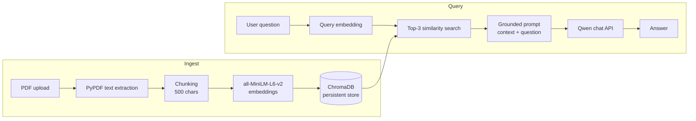

# RAG Document Assistant


-6B46C1)


A local-first Retrieval-Augmented Generation assistant for PDF documents: upload a PDF, ask questions in plain language, and get answers grounded in the document's own text.

Document chunking and embeddings run **entirely on the local machine** (`all-MiniLM-L6-v2` via `sentence-transformers`). Only the retrieved fragments and the question are sent to the LLM for answer generation.


---

## Features

- **Upload from the browser** — no CLI required to index a new document.
- **Persistent vector store** — the index lives in ChromaDB on disk and survives restarts.
- **Grounded answers** — top-3 retrieved chunks are injected into the prompt, with an explicit "say you don't know" instruction so the model cannot free-style.
- **Local embeddings** — zero embedding cost, no document text shipped to a third-party embedding API.
- **Two entry points** — Streamlit chat UI (`ui.py`) and a CLI Q&A loop (`query.py`) for quick experiments.
- **One-click reset** — the sidebar can drop the collection and clear the chat.

## Architecture



## How it works

1. **Ingestion** — `pypdf` extracts text page by page from the uploaded PDF.
2. **Chunking** — the text is split into fixed 500-character windows.
3. **Embedding** — every chunk is encoded locally by `all-MiniLM-L6-v2` (384-dim vectors).
4. **Storage** — vectors, chunk text, and `{source, chunk}` metadata go into a persistent ChromaDB collection, keyed by `{filename}_{index}` and written with `upsert`, so re-indexing the same file overwrites its chunks instead of failing on duplicate ids.
5. **Retrieval** — the question is embedded with the same model and matched against the store; the 3 nearest chunks become the context.
6. **Generation** — the context and the question are composed into a single grounded prompt and sent to `qwen-plus` through the OpenAI-compatible DashScope endpoint.

## Tech stack

| Layer | Choice |
|---|---|
| UI | Streamlit |
| PDF parsing | pypdf |
| Embeddings | sentence-transformers `all-MiniLM-L6-v2` (local) |
| Vector store | ChromaDB (`PersistentClient`) |
| LLM | Qwen via DashScope, OpenAI-compatible API |
| Config | python-dotenv |

## Quick start

**Prerequisites:** Python 3.11+, and a Qwen / DashScope API key.

```powershell
python -m venv venv
.\venv\Scripts\Activate.ps1
pip install -r requirements.txt
```

Create a `.env` file in the project root (it is git-ignored):

```ini
QWEN_API_KEY=sk-your-key-here
QWEN_BASE_URL=https://dashscope-intl.aliyuncs.com/compatible-mode/v1
QWEN_MODEL=qwen-plus
```

Launch the web UI:

```powershell
streamlit run ui.py
```

Streamlit opens `http://localhost:8501`. Upload a PDF in the sidebar → **Process Document** → ask questions in the chat box.

Console mode:

```powershell
python app.py     # indexes data/real.pdf
python query.py   # interactive Q&A with retry/backoff
```

> The model name is read from `QWEN_MODEL` (default `qwen-plus`). If a model returns `404 Model not exist`, the endpoint does not serve that model — pick one available on your DashScope account.

## Project structure

```
rag-document-assistant/
├── app.py              # CLI ingestion: PDF -> chunks -> embeddings -> ChromaDB
├── query.py            # CLI Q&A loop with exponential backoff on API errors
├── ui.py               # Streamlit app: upload, index, chat
├── requirements.txt    # pinned dependencies
├── data/               # source PDFs (git-ignored)
├── chroma_db/          # persisted vector store (git-ignored)
├── docs/
│   └── demo.png        # UI screenshot used above
└── LICENSE
```

## Design notes

- **Local embeddings over API embeddings.** Indexing is free and reproducible offline; a 70 KB PDF indexes in seconds on CPU.
- **`st.cache_resource` for the model.** Streamlit reruns the script on every interaction — without caching, the embedding model would reload each turn.
- **`upsert` + filename-scoped ids.** Naive positional ids (`doc_0`, `doc_1`, …) collide as soon as a second document is uploaded.
- **Prompt constraint.** "If you don't know the answer, say that you don't know" — a small change that measurably cuts hallucination on out-of-context questions.

## Limitations & roadmap

Honest state of the project:

- **Chunking is naive** — fixed 500-character windows with no overlap; they cut across sentences and paragraphs.
- **No reranker** — retrieval is raw vector similarity on 3 chunks; no cross-encoder or MMR/diversity step.
- **Citations not surfaced** — source metadata is stored but the UI does not yet show which chunk or page an answer came from.
- **Stale tails** — re-uploading an edited PDF with fewer chunks leaves the old trailing chunks in the collection.
- **No evaluation set yet** — the next milestone is 15–20 hand-written Q/A pairs with hit-rate and faithfulness metrics, so retrieval changes can be measured instead of eyeballed.
- **Single collection, single file** — multi-document workspaces and per-document filtering are not implemented.

Planned order: page-number citations → overlapping chunking → evaluation set → reranking.

## 中文简介

面向 PDF 文档的检索增强生成（RAG）问答助手。文档切分与向量化完全在本地完成（`all-MiniLM-L6-v2`），只有检索到的片段与问题会发送给 Qwen 生成答案。

- **技术栈**：Streamlit + pypdf + sentence-transformers + ChromaDB + Qwen（DashScope OpenAI 兼容接口）
- **流程**：PDF 解析 → 500 字符切块 → 本地向量化 → 持久化存储 → Top-3 检索 → 拼接上下文 → 调用大模型作答
- **运行**：配置 `.env` 中的 `QWEN_API_KEY` / `QWEN_BASE_URL` 后，执行 `streamlit run ui.py`

## License

MIT — see [LICENSE](LICENSE).
